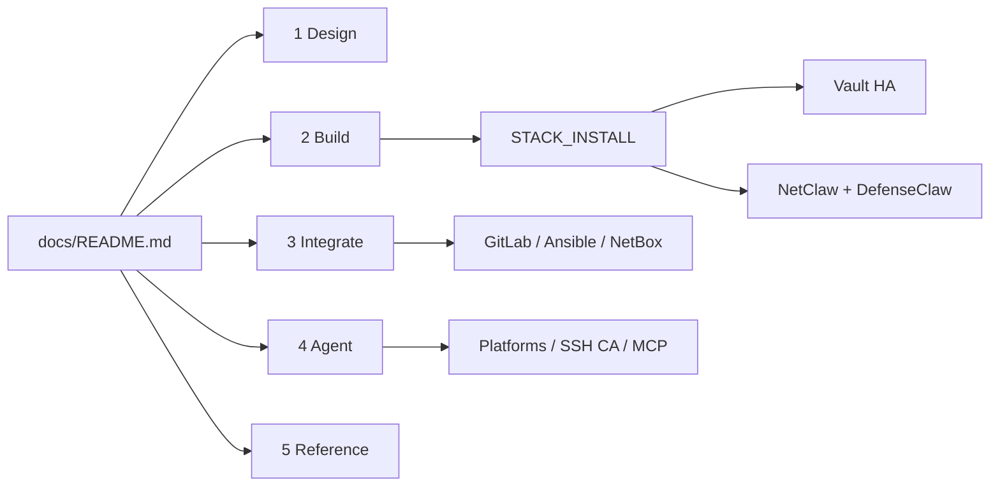
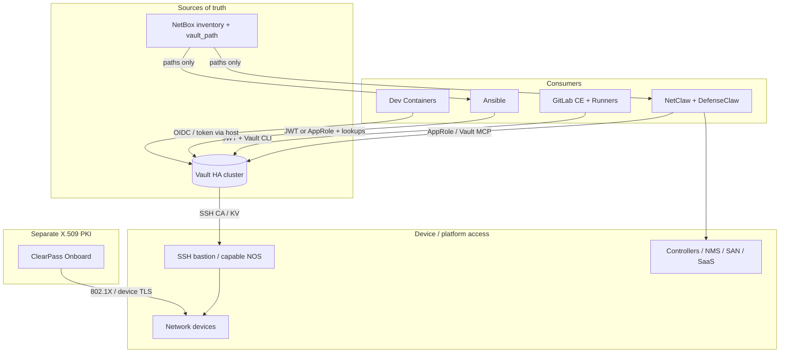

# NetClaw production stack documentation

Complete **production** documentation for **NetClaw** and associated components — with **HashiCorp Vault** as the secrets system of record for **GitLab CE**, **Ansible**, **NetBox**, **Dev Containers**, **DefenseClaw**, MCP servers, and your network platforms (CVaaS, Strata, Central, Nexus Dashboard SAN, Cloudflare, IOS-XR, and more).

## Start here

| Audience | Go to |
|----------|--------|
| **Install everything (operators)** | **[docs/STACK_INSTALL.md](docs/STACK_INSTALL.md)** — full stack runbook |
| **Doc map / reading path** | [docs/README.md](docs/README.md) |
| **Vault HA only** | [docs/INSTALL.md](docs/INSTALL.md) |
| **Delivery / project plan** | [docs/WORKPLAN.md](docs/WORKPLAN.md) |
| **Security controls** | [docs/SECURITY.md](docs/SECURITY.md) |
| **Best practices (all topics)** | [docs/BEST_PRACTICES.md](docs/BEST_PRACTICES.md) |
| **MCP explained** | [docs/MCP.md](docs/MCP.md) |
| **NetClaw → production platforms** | [docs/PRODUCTION_ENVIRONMENTS.md](docs/PRODUCTION_ENVIRONMENTS.md) |
| **Diagrams** | [docs/DIAGRAMS.md](docs/DIAGRAMS.md) |



## Stack at a glance

| Component | Role |
|-----------|------|
| **HashiCorp Vault** (HA) | Secrets SoT (KV, SSH CA, optional PKI) |
| **NetClaw + OpenClaw** | Agentic network engineering runtime |
| **DefenseClaw** | MCP scan + runtime guardrails |
| **MCP servers** | Tools (Vault, Zabbix, CVaaS, Cloudflare, …) |
| **GitLab CE + Runners** | JWT → Vault CLI |
| **Ansible** | `community.hashi_vault` lookups |
| **NetBox Community** | Inventory + `vault_path` (no passwords) |
| **VS Code Dev Containers** | Host Vault auth via `remoteEnv` / OIDC |
| **ClearPass Onboard** | X.509 / NAC (separate from SSH CA) |

## System overview



## Production deploy path

1. Sign off architecture + security ([docs/ARCHITECTURE.md](docs/ARCHITECTURE.md), [docs/SECURITY.md](docs/SECURITY.md)).
2. Follow **[docs/STACK_INSTALL.md](docs/STACK_INSTALL.md)** (includes Vault HA, NetBox, GitLab, Ansible, NetClaw, DefenseClaw, models, SSH CA, platforms).
3. Complete STACK_INSTALL §12 acceptance; operate per [docs/WORKPLAN.md](docs/WORKPLAN.md) Phase 7.

Pin versions after change control ([docs/VERSIONS.md](docs/VERSIONS.md)). Scripts under `scripts/` are **reference helpers only** — not a production installer.

## Repository layout

```
.
├── README.md          ← landing
├── docs/              ← guides (STACK_INSTALL.md = full install)
├── policies/          ← example Vault HCL (stage + prod)
├── scripts/           ← non-production command references
└── examples/          ← CI / Ansible / MCP / platforms / checklists
```

| Folder | Index |
|--------|--------|
| [docs/](docs/README.md) | All guides in reading order |
| [examples/](examples/README.md) | Copy-paste snippets by topic |
| [policies/](policies/README.md) | Vault ACL examples |
| [scripts/](scripts/README.md) | Non-prod reference helpers |

## Security note

Examples use **placeholders only**. Never commit real tokens, unseal/recovery keys, or device passwords. Production consumers **fail closed** when Vault is unavailable.
