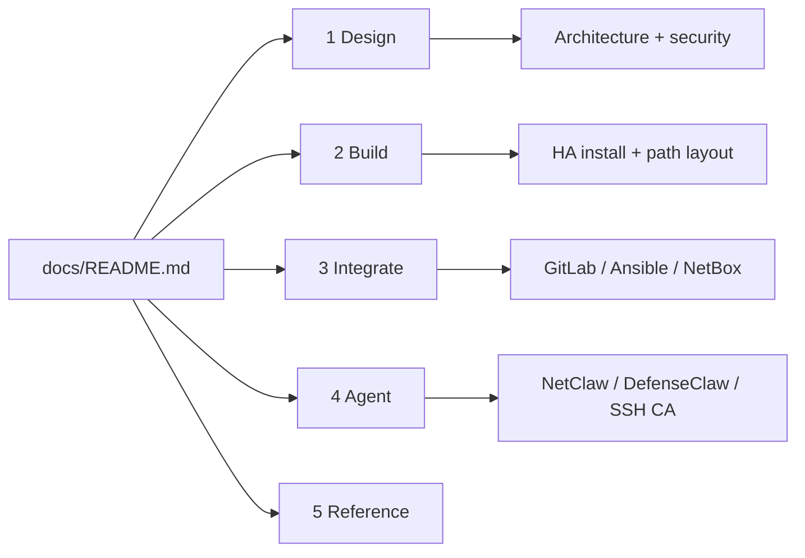
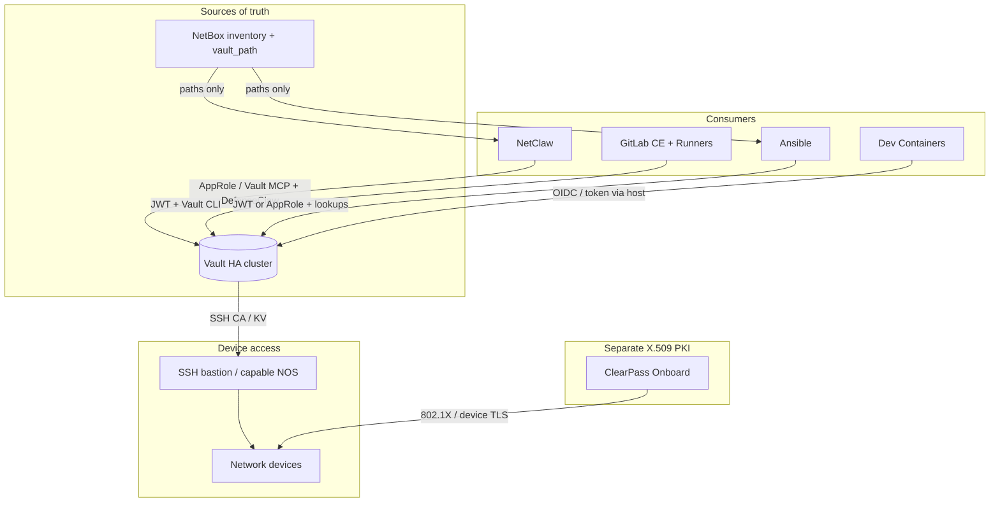

# Vault Documentation

**HashiCorp Vault** as the secrets system of record for **production** agentic network troubleshooting with **GitLab CE**, **Ansible**, **NetBox**, **Dev Containers**, and **NetClaw**.

## Start here

| Audience | Go to |
|----------|--------|
| **First-time readers** | **[docs/README.md](docs/README.md)** — reading path & doc hub |
| **Operators deploying Vault** | [docs/INSTALL.md](docs/INSTALL.md) — HA Raft, TLS, auto-unseal |
| **Delivery / project plan** | [docs/WORKPLAN.md](docs/WORKPLAN.md) |
| **Security controls** | [docs/SECURITY.md](docs/SECURITY.md) |
| **Best practices (all topics)** | [docs/BEST_PRACTICES.md](docs/BEST_PRACTICES.md) |
| **NetClaw → production platforms** | [docs/PRODUCTION_ENVIRONMENTS.md](docs/PRODUCTION_ENVIRONMENTS.md) |
| **Diagrams** | [docs/DIAGRAMS.md](docs/DIAGRAMS.md) |



## Stack at a glance

| Component | Role |
|-----------|------|
| **HashiCorp Vault** (HA) | Secrets SoT (KV, SSH CA, optional PKI) |
| **GitLab CE + Runners** | JWT → Vault CLI (Premium `secrets:vault` optional) |
| **Ansible** | `community.hashi_vault` lookups |
| **VS Code Dev Containers** | Host Vault auth via `remoteEnv` / OIDC |
| **NetBox Community** | Inventory + `vault_path` (no passwords) |
| **NetClaw** | Agent + Vault MCP |
| **DefenseClaw** | Open-source MCP scan + runtime guardrails ([docs/DEFENSECLAW.md](docs/DEFENSECLAW.md)) |
| **ClearPass Onboard** | X.509 / NAC (separate from SSH CA) |

## System overview



## Production deploy path

1. Sign off architecture + security ([docs/ARCHITECTURE.md](docs/ARCHITECTURE.md), [docs/SECURITY.md](docs/SECURITY.md)).
2. Deploy a **3+ node** Raft cluster with TLS and auto-unseal ([docs/INSTALL.md](docs/INSTALL.md)).
3. Lock path Strategy A for `stage` / `prod` ([docs/PATH_LAYOUT.md](docs/PATH_LAYOUT.md)).
4. Wire GitLab CE JWT roles (separate stage vs prod) → Ansible → NetBox → NetClaw.
5. Enable DefenseClaw (observe→action) around Vault MCP; roll SSH CA + zero-touch bastion trust; complete backup restore drill.

Pin versions after change control ([docs/VERSIONS.md](docs/VERSIONS.md)). Scripts under `scripts/` are **reference helpers only** — not a production installer.

## Repository layout

```
.
├── README.md          ← landing
├── docs/              ← guides (start at docs/README.md)
├── policies/          ← example Vault HCL (stage + prod)
├── scripts/           ← non-production command references
└── examples/          ← CI / Ansible / SSH CA / LLM snippets
```

| Folder | Index |
|--------|--------|
| [docs/](docs/README.md) | All guides in reading order |
| [examples/](examples/README.md) | Copy-paste snippets by topic |
| [policies/](policies/README.md) | Vault ACL examples |
| [scripts/](scripts/README.md) | Non-prod reference helpers |

## Security note

Examples use **placeholders only**. Never commit real tokens, unseal/recovery keys, or device passwords. Production consumers **fail closed** when Vault is unavailable.
