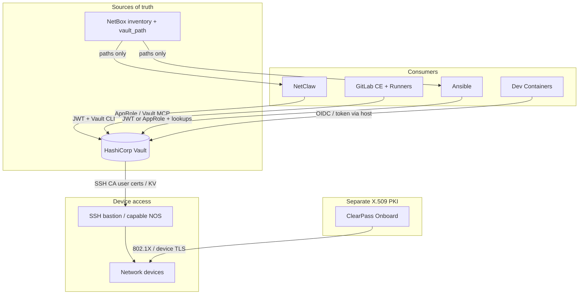

# NetClaw Vault Secrets

Workplan and install setup for **HashiCorp Vault** as the secrets system of record for an agentic network-troubleshooting stack:

| Component | Role |
|-----------|------|
| **HashiCorp Vault** | Secrets vault (SSH creds, API tokens, short-lived certs) |
| **GitLab (on-prem)** | Source control + CI/CD JWT auth into Vault |
| **GitLab Runners** | Runtime that fetches secrets at job start |
| **Ansible playbooks** | Runtime lookups via `community.hashi_vault` (CI + local) |
| **VS Code Dev Containers** | Host Vault auth → `remoteEnv` / token mount (no secrets in image) |
| **NetBox Community** | Inventory / source of truth (paths & metadata, not passwords) |
| **NetClaw** | Agentic network engineer via Vault MCP |

## Versions

Docs and examples assume **latest stable** releases (Vault 2.x, Ollama, `community.hashi_vault`, etc.). See **[docs/VERSIONS.md](docs/VERSIONS.md)**. Pin tags in production after lab validation.

## Why Vault

- Native GitLab `secrets:vault` + JWT/OIDC (no long-lived CI tokens)
- NetBox Discovery / Orb Agent can resolve Vault references
- NetClaw ships a first-class **HashiCorp Vault MCP** integration
- SSH secrets engine supports short-lived OTP / certificates for agents
- Works fully on-prem

## System overview



More diagrams: **[docs/DIAGRAMS.md](docs/DIAGRAMS.md)**.

## Docs

| Doc | Purpose |
|-----|---------|
| [WORKPLAN.md](docs/WORKPLAN.md) | Phased delivery plan, owners, acceptance criteria |
| [INSTALL.md](docs/INSTALL.md) | End-to-end install and bootstrap |
| [PATH_LAYOUT.md](docs/PATH_LAYOUT.md) | Vault mount/path strategies (env/site/device designs) |
| [SSH_CA.md](docs/SSH_CA.md) | Vault SSH CA mode, ClearPass Onboard vs X.509, bastions |
| [ARCHITECTURE.md](docs/ARCHITECTURE.md) | Trust boundaries and data flow |
| [GITLAB.md](docs/GITLAB.md) | JWT auth + Vault for CE (CLI) and Premium (`secrets:vault`) |
| [ANSIBLE.md](docs/ANSIBLE.md) | Migrate playbooks off Ansible Vault / CI passwords |
| [DEVCONTAINERS.md](docs/DEVCONTAINERS.md) | VS Code Dev Containers without committed secrets |
| [NETBOX.md](docs/NETBOX.md) | Inventory references, tokens, Orb Agent |
| [NETCLAW.md](docs/NETCLAW.md) | Vault MCP, policies, safe agent access |
| [MODELS.md](docs/MODELS.md) | Claude vs OpenAI vs local LLMs for NetClaw |
| [LOCAL_LLM.md](docs/LOCAL_LLM.md) | Install Ollama + recommended Qwen3 models for NetClaw |
| [VERSIONS.md](docs/VERSIONS.md) | Latest-stable version policy and current release snapshot |
| [SECURITY.md](docs/SECURITY.md) | Least privilege, audit, rotation |
| [DIAGRAMS.md](docs/DIAGRAMS.md) | Index of architecture / flow diagrams |

## Quick start (lab)

```bash
# On a Linux host with Docker
cd scripts
./01-bootstrap-vault.sh
./02-enable-engines.sh
./03-write-sample-secrets.sh
./04-configure-approle.sh
```

Then wire GitLab JWT ([GITLAB.md](docs/GITLAB.md)), Ansible ([ANSIBLE.md](docs/ANSIBLE.md)), Dev Containers ([DEVCONTAINERS.md](docs/DEVCONTAINERS.md)), NetClaw MCP ([NETCLAW.md](docs/NETCLAW.md)), model choice ([MODELS.md](docs/MODELS.md)), and local LLM install ([LOCAL_LLM.md](docs/LOCAL_LLM.md)).

## Package layout

```
.
├── README.md
├── docs/           # Workplan + install + transition guides
├── policies/       # Example Vault HCL policies
├── scripts/        # Bootstrap helpers (lab/prod-shaped)
└── examples/       # GitLab CI, Ansible, Dev Container, Orb, NetClaw snippets
```

## Security note

Scripts and examples use **placeholders only**. Never commit real tokens, root tokens, unseal keys, or device passwords. Store production secrets in Vault; keep GitLab variables limited to Vault addressing and auth config.
