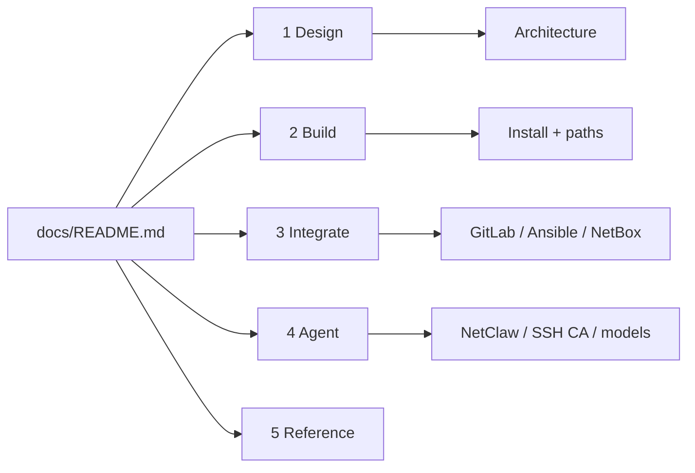
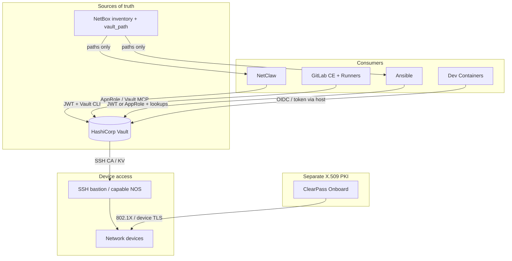

# Vault Documentation

**HashiCorp Vault** as the secrets system of record for agentic network troubleshooting with **GitLab CE**, **Ansible**, **NetBox**, **Dev Containers**, and **NetClaw**.

## Start here

| Audience | Go to |
|----------|--------|
| **First-time readers** | **[docs/README.md](docs/README.md)** — reading path & doc hub |
| **Operators installing Vault** | [docs/INSTALL.md](docs/INSTALL.md) |
| **Delivery / project plan** | [docs/WORKPLAN.md](docs/WORKPLAN.md) |
| **Diagrams** | [docs/DIAGRAMS.md](docs/DIAGRAMS.md) |



## Stack at a glance

| Component | Role |
|-----------|------|
| **HashiCorp Vault** | Secrets SoT (KV, SSH CA, optional PKI) |
| **GitLab CE + Runners** | JWT → Vault CLI (Premium `secrets:vault` optional) |
| **Ansible** | `community.hashi_vault` lookups |
| **VS Code Dev Containers** | Host Vault auth via `remoteEnv` |
| **NetBox Community** | Inventory + `vault_path` (no passwords) |
| **NetClaw** | Agent + Vault MCP |
| **ClearPass Onboard** | X.509 / NAC (separate from SSH CA) |

## System overview



## Lab quick start

```bash
cd scripts
./01-bootstrap-vault.sh
./02-enable-engines.sh
./03-write-sample-secrets.sh
./04-configure-approle.sh
```

Then follow **[docs/README.md](docs/README.md)** from **Build → Integrate**. Versions: [docs/VERSIONS.md](docs/VERSIONS.md).

## Repository layout

```
.
├── README.md          ← you are here (landing)
├── docs/              ← guides (start at docs/README.md)
├── policies/          ← example Vault HCL
├── scripts/           ← lab bootstrap
└── examples/          ← CI / Ansible / SSH CA / LLM snippets
```

| Folder | Index |
|--------|--------|
| [docs/](docs/README.md) | All guides in reading order |
| [examples/](examples/README.md) | Copy-paste snippets by topic |
| [policies/](policies/README.md) | Vault ACL examples |
| [scripts/](scripts/README.md) | Bootstrap helpers |

## Security note

Examples use **placeholders only**. Never commit real tokens, unseal keys, or device passwords. Production: pin image/package versions after lab validation ([VERSIONS.md](docs/VERSIONS.md)).
