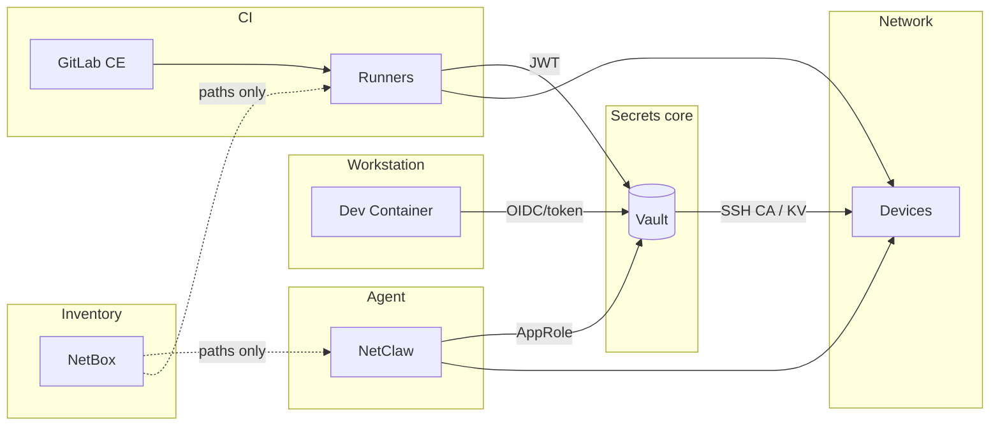
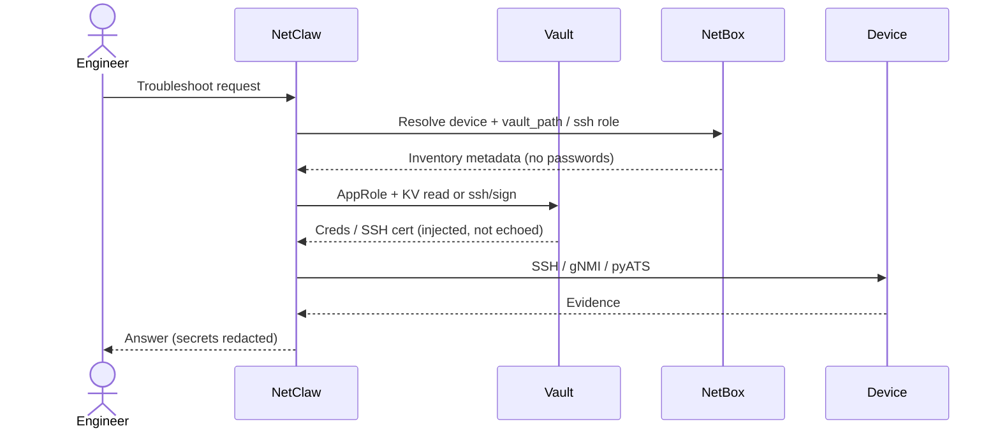
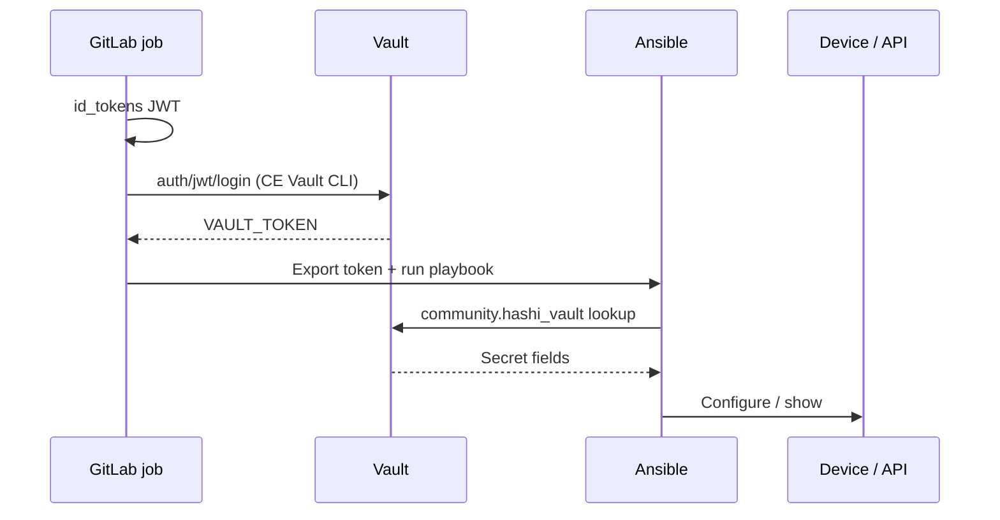
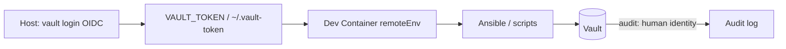
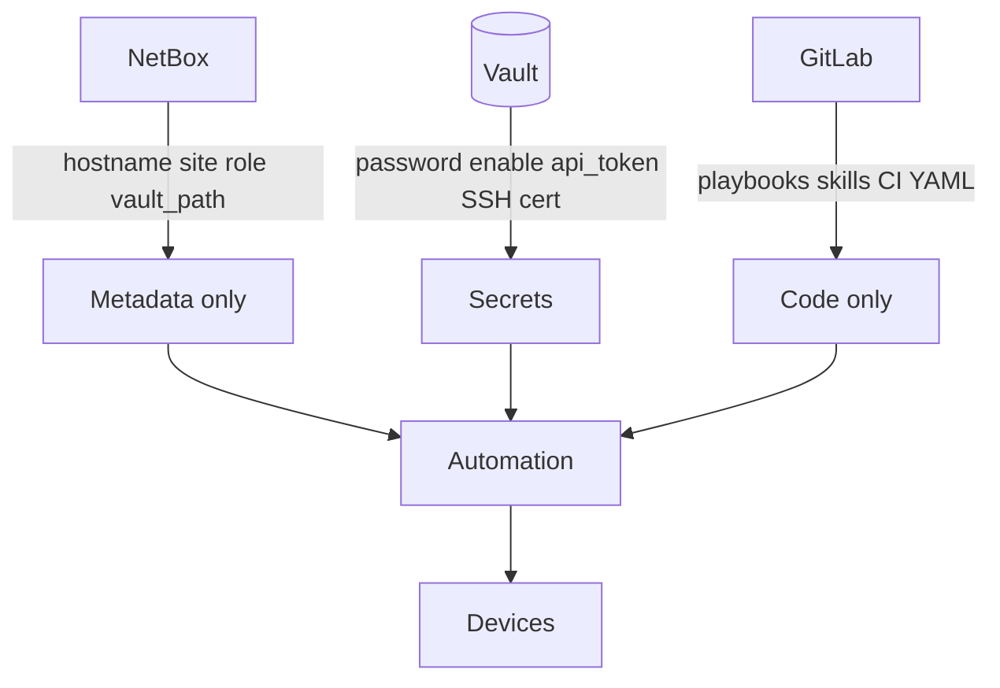
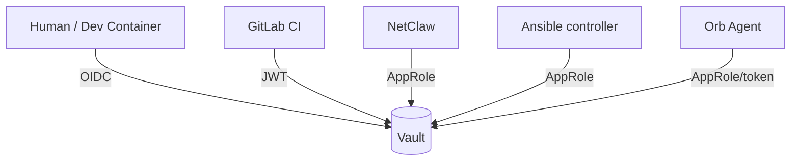
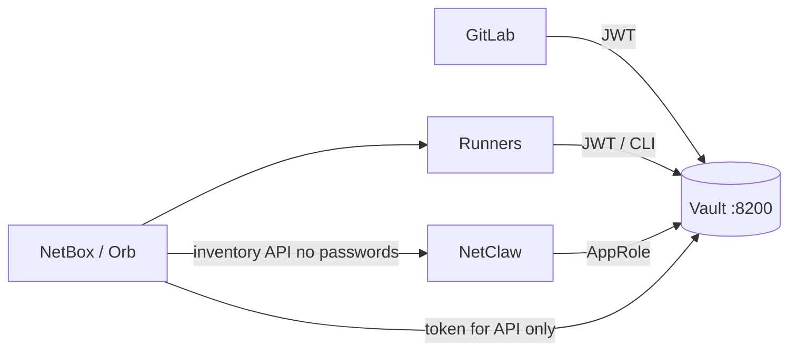

# Architecture

<!-- doc-nav:start -->
> **Hub:** [Documentation home](README.md) · **1. Design**  
> [Security](SECURITY.md) →
<!-- doc-nav:end -->

Trust zones and data flows for Vault as secrets SoT. Start the full reading path at [Documentation home](README.md).

## Trust boundaries

| Zone | Components | Secrets access |
|------|------------|----------------|
| **Secrets core** | Vault cluster, unseal operators, audit storage | All mounts (admin only) |
| **CI** | GitLab CE + Runners, Ansible in CI | JWT → Vault CLI (CE) or `secrets:vault` (Premium+) → role-scoped KV |
| **Workstation** | VS Code Dev Containers, local Ansible | OIDC/token/AppRole via host → `remoteEnv` |
| **Inventory** | NetBox Community, optional Orb Agent | Token in Vault; device *paths* in NetBox |
| **Agent** | NetClaw + Vault MCP + DefenseClaw + LLM (Claude/OpenAI/local) | AppRole → read (default); change role gated; model choice in [MODELS.md](MODELS.md) |
| **Network devices** | Routers/switches/firewalls | Accept SSH cert/OTP or static user from Vault |

## Data flow (troubleshoot)

## Data flow (CI / Ansible)

Premium+ may replace the CLI login with declarative `secrets:vault` injection — see [GITLAB.md](GITLAB.md).

## Data flow (Dev Container)

## What lives where

| Data | Store |
|------|-------|
| Device hostname, role, site, IP, platform | **NetBox** |
| Vault path / credential role name | **NetBox** custom field or naming convention |
| Username / password / enable / API tokens | **Vault KV** (`secret/network/{env}/{site}/{device}/…`) |
| Short-lived SSH | **Vault SSH CA** ([SSH_CA.md](SSH_CA.md)) |
| X.509 / 802.1X / many device TLS certs | **HPE ClearPass Onboard** (existing) |
| Automation code / Dev Container definition | **GitLab** (no secret values) |
| Agent skills / MCP config | **NetClaw host** (no secret values in git) |

Path strategies and alternatives: [PATH_LAYOUT.md](PATH_LAYOUT.md).

## Auth method map

| Client | Auth | Policy |
|--------|------|--------|
| Human admins / Dev Containers | OIDC or short-lived token | lab read / ops |
| GitLab CI / Ansible in CI | JWT | `gitlab-ci` or `ansible-automation` |
| Ansible controller (non-CI) | AppRole | `ansible-automation` |
| NetClaw | AppRole | `netclaw-read` / `netclaw-change` |
| Orb / discovery | AppRole or token | `netbox-agent` |

## Failure modes

| Failure | Expected behavior |
|---------|-------------------|
| Vault sealed / down | Jobs and NetClaw fail closed |
| Wrong GitLab branch | JWT role denies `prod/` |
| NetClaw asks for secret display | MCP/skill redacts; inject to file/tool only |
| Compromised AppRole secret-id | Rotate secret-id; audit prior reads |

## Network diagram (logical)

<!-- doc-footer:start -->
---

**Hub:** [Documentation home](README.md) · **Reading path:** [Design](ARCHITECTURE.md) → [Build](INSTALL.md) → [Integrate](GITLAB.md) → [Agent](NETCLAW.md) → [Reference](DIAGRAMS.md)
<!-- doc-footer:end -->
