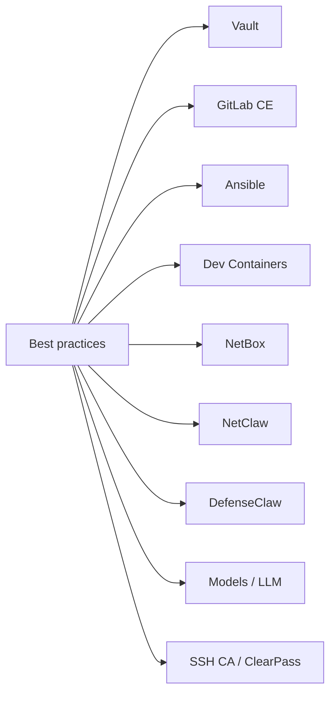

# Best practices by topic

<!-- doc-nav:start -->
> **Hub:** [Documentation home](README.md) · **1. Design**  
> ← [Workplan](WORKPLAN.md) · [Versions](VERSIONS.md) →
<!-- doc-nav:end -->

Production best practices for **NetClaw** and every associated component in this stack. Each section is a checklist; deep procedures live in the linked guides.

---

## Cross-cutting (whole stack)

| Do | Don't |
|----|--------|
| Treat **Vault** as the only secrets SoT | Store device passwords in Git, NetBox, or CI variables |
| **Fail closed** when Vault or DefenseClaw is down | Fall back to plaintext `.env` / Ansible Vault “just this once” |
| **Pin** package and image versions ([VERSIONS.md](VERSIONS.md)) | Run `:latest` in production |
| Separate **stage** vs **prod** identities and policies | One JWT/AppRole that can read all of `network/*` |
| Ship **Vault audit + DefenseClaw alerts + CI logs** to SIEM | Rely on a single log source |
| Promote **stage → prod** after audit review | Point NetClaw at prod on day one |
| Document break-glass offline | Put recovery keys or root tokens in git / chat |

---

## 1. Architecture & trust

Guide: [ARCHITECTURE.md](ARCHITECTURE.md)

- Keep clear zones: secrets core, CI, workstation, inventory, agent, devices.
- NetBox = inventory + `vault_path` / role names only; Vault = secret *values*.
- GitLab holds code and CI YAML — never secret values.
- Prefer short-lived **SSH certificates** over static device passwords for agents.
- Consumers use different **auth** (JWT / AppRole / OIDC) even when they share **paths**.

---

## 2. Security controls

Guide: [SECURITY.md](SECURITY.md)

- Enforce least privilege: `gitlab-ci` (stage), `gitlab-ci-prod`, `netclaw-read`, `netclaw-change`, `ansible-automation`, `netbox-agent`.
- TTLs: CI tokens ~15m; NetClaw AppRole ~1h; SSH certs 15–30m; rotate AppRole secret-ids on a calendar.
- Revoke root after bootstrap; multi-party escrow for recovery keys; auto-unseal for day-2.
- Alert on seal, Raft peer loss, prod path read spikes, auth failures, root/recovery use.
- On credential leak: revoke token/secret-id → rotate KV → invalidate SSH certs → review audit → treat chat transcripts as compromised if secrets appeared.

---

## 3. Full stack install order

Guide: [STACK_INSTALL.md](STACK_INSTALL.md)

- Install in runbook order: Vault → paths/policies → NetBox → GitLab/Ansible → SSH CA → NetClaw/MCP → DefenseClaw → models → platforms → Dev Containers → validate.
- Do not point NetClaw at production controllers before Vault HA, DefenseClaw soak, and stage smoke tests pass.
- Use the printable checklist: [`../examples/stack-install/checklist.md`](../examples/stack-install/checklist.md).

---

## 4. Vault platform (install & operate)

Guide: [INSTALL.md](INSTALL.md)

| Practice | Detail |
|----------|--------|
| HA | **3+** Raft voters behind a TLS VIP / LB |
| TLS | Enterprise/internal CA; clients set `VAULT_CACERT` — never `VAULT_SKIP_VERIFY` |
| Unseal | Auto-unseal (KMS / HSM / Transit); no day-2 human Shamir |
| Audit | Always on; ship off-box |
| Backup | Scheduled Raft snapshots; restore drill before cutover and regularly after |
| Forbidden | `-dev`, `tls_disable`, Docker lab containers for real secrets |
| Scripts | `scripts/` are **reference only** — not a production installer |

---

## 5. Versions & change control

Guide: [VERSIONS.md](VERSIONS.md)

- Pin Vault, vault-mcp, DefenseClaw, Ollama, NetClaw/OpenClaw, `community.hashi_vault`, `hvac`.
- Verify DefenseClaw (and optional OpenShell) installers against release checksums / reviewed digests.
- Record resolved versions in image build logs or lockfiles at every promote.
- Upgrade Vault with snapshot → rolling restart → `raft list-peers` verify.

---

## 6. Path layout (KV)

Guide: [PATH_LAYOUT.md](PATH_LAYOUT.md)

- Default **Strategy A**: `network/{env}/{site}/{device}/credentials` on mount `secret/`.
- Primary envs: **`stage`** and **`prod`** (optional isolated `lab` gear — not a Vault install mode).
- Stable fields: `username`, `password`, `enable_secret`.
- Platform tokens under `secret/platform/…` (e.g. NetBox) — not under device trees.
- Prefer SSH CA over shared `network/{env}/shared/netclaw` passwords in production.
- Separate Vault policies per env; test denies with non-root tokens before cutover.

---

## 7. GitLab CE + Runners

Guide: [GITLAB.md](GITLAB.md)

- Use **`id_tokens` + Vault CLI** (CE has no `secrets:vault`).
- Separate JWT roles/policies for stage vs prod; bind `project_path` + `ref_protected`.
- MR / unprotected pipelines must not read `prod/`.
- Protected runners for prod jobs; set `VAULT_CACERT` (File variable).
- Never echo secret values; prefer temp files mode `600`; assume no Premium auto-masking.
- Pin the Vault CLI image tag in job YAML.
- Remove plaintext CI variables after Vault cutover validation.

---

## 8. Ansible

Guide: [ANSIBLE.md](ANSIBLE.md)

- Use `community.hashi_vault` lookups; commit **paths** only (`vault_paths.yml`).
- `no_log: true` on tasks that touch passwords / enable / tokens.
- CI: JWT → `VAULT_TOKEN` → lookups; human Dev Containers: OIDC — not the CI JWT.
- Pin collection + `hvac` in requirements / images.
- No `default(old_plaintext)` leftovers after cutover.
- Stage playbook first; promote inventory + JWT role for prod.

---

## 9. Dev Containers

Guide: [DEVCONTAINERS.md](DEVCONTAINERS.md)

- No secrets in Dockerfile, committed `.env`, or image layers.
- Pass `VAULT_ADDR` / token via `remoteEnv` after host `vault login` (OIDC preferred).
- Stage-scoped policies for engineers; prod via separate role or break-glass.
- Missing token must fail closed — same playbooks as CI, different audit identity.

---

## 10. NetBox

Guide: [NETBOX.md](NETBOX.md)

- NetBox holds **inventory + `vault_path` / `vault_ssh_role` / `credential_env`** — never device passwords.
- Store the NetBox API token in Vault (`secret/platform/netbox`); rotate without code changes.
- Prefer NetBox-driven derivation only when `vault_path` is unset; document which rule wins.
- End-to-end validate: NetBox resolve → Vault read/sign → login on **stage**, then prod.

---

## 11. MCP (Model Context Protocol)

Guide: [MCP.md](MCP.md)

- Treat MCP as the tool plumbing; Vault holds secrets; DefenseClaw governs calls.
- Register servers via `mcpServers` (stdio `command`/`args`/`env`); never commit live tokens in JSON.
- Start with `vault-mcp`; scan with DefenseClaw; smoke-test with redacted prompts only.
- Log MCP servers to stderr only — stdout is the protocol channel.

---

## 12. NetClaw + Vault MCP

Guide: [NETCLAW.md](NETCLAW.md)

- Authenticate with **AppRole** (`netclaw-read` default); refresh tokens on a schedule shorter than TTL.
- Never use root or long-lived static tokens in production.
- Secret **values** must not appear in chat, Canvas, SOUL, skills, or logs — **inject** into tools/files only.
- Prefer Vault SSH CA sign over static device passwords.
- Register `vault-mcp-server` with pinned binary; env from host files outside git.
- Treat visible secrets in chat as an incident ([SECURITY.md](SECURITY.md)).

---

## 13. DefenseClaw (+ optional OpenShell)

Guide: [DEFENSECLAW.md](DEFENSECLAW.md)

- Require DefenseClaw for production NetClaw; pin release; verify installer checksums — do not pipe `main` to bash.
- OpenClaw connector; durable `defenseclaw-gateway` sidecar; `security.mode=defenseclaw`.
- Start guardrails in **observe**; promote to **action** after stage soak.
- Register + **scan** `vault-mcp` (and all MCPs) before allow; fix HIGH/CRITICAL findings.
- Register custom LLM domains (e.g. Ollama) — unknown providers fail closed.
- Default: block destructive / write tools; open only inside approved change windows.
- Change window: DefenseClaw tool allow → short-lived `netclaw-change` → execute → revoke → re-block ([examples/defenseclaw/](../examples/defenseclaw/)).
- OpenShell optional: allowlist Vault VIP, NetBox, GitLab, LLM; deny host SSH keys and Vault key material mounts.
- Correlate DefenseClaw alerts with Vault audit in SIEM.

---

## 14. Models (Claude / OpenAI / local)

Guide: [MODELS.md](MODELS.md)

- **Main**: Claude (preferred for tool-heavy NetClaw); OpenAI if mandated; local only with serious GPU / air-gap.
- **Fallback** and **Compaction**: often local (`qwen3:8b`) or cheaper cloud tier.
- Model choice does **not** replace Vault, DefenseClaw, or redaction.
- Validate one **stage** troubleshoot E2E before prod devices.
- API keys only via Vault / host secret files — never in the GitLab repo.

---

## 15. Local LLM (Ollama)

Guide: [LOCAL_LLM.md](LOCAL_LLM.md)

- Pin Ollama and model tags; dedicated GPU host for production Main/fallback when local is required.
- Do not use undersized CPU-only hosts as production Main.
- Register Ollama with DefenseClaw provider setup.
- Keep write tools gated even when the model is local.
- Compose/` :latest` sketches are not production — pin digests ([VERSIONS.md](VERSIONS.md)).

---

## 16. Production environments (controllers / NMS / XR)

Guide: [PRODUCTION_ENVIRONMENTS.md](PRODUCTION_ENVIRONMENTS.md)

- Store every controller token under `secret/platform/…`; IOS-XR under `secret/network/…` + prefer SSH CA.
- Register and DefenseClaw-scan each MCP (CVaaS, Cloudflare, Zabbix, Aruba Central classic/CNX, Nexus Dashboard SAN, etc.).
- NetBox holds URLs, org IDs, `vault_path`, controller tags — never API secrets.
- Enable read-only / stage first; gate SaaS, EPNM, and **SAN zoning** writes behind change windows.
- Prefer Nexus Dashboard **API keys** over interactive ND login passwords for automation.
- Allowlist egress per SaaS/on-prem API (include ND VIP); XR via bastion/SSH CA ([SSH_CA.md](SSH_CA.md)).

---

## 17. SSH CA, ClearPass, zero-touch

Guide: [SSH_CA.md](SSH_CA.md) · [INSTALL.md](INSTALL.md) §8

| System | Use for | Do not use for |
|--------|---------|----------------|
| **Vault SSH CA** | Automation SSH (NetClaw, Ansible, bastions) | 802.1X / NAC X.509 |
| **ClearPass Onboard** | X.509, 802.1X, device TLS (SCEP/EST) | OpenSSH `TrustedUserCAKeys` |

- Prefer **CA mode** over OTP for production scale.
- Separate troubleshoot vs change SSH roles; short TTLs; audit every `ssh/sign`.
- Seed **CA public key only** via golden image and/or NetBox→GitLab→Ansible; never bake user certs into images.
- Bastion pattern when NOS lacks SSH cert support.
- Zero-touch: no interactive engineer SSH to enroll new hosts.

---

## 18. Policies & examples

Guides: [../policies/README.md](../policies/README.md) · [../examples/README.md](../examples/README.md)

- Apply env-scoped HCL; never one identity across stage+prod.
- Examples are placeholders — replace `CHANGE_ME`; do not leave samples on a live cluster.
- CI snippets: pin image tags; use `gitlab-network-stage` / `gitlab-network-prod` roles.

---

## 19. Operate & harden (ongoing)

Guide: [WORKPLAN.md](WORKPLAN.md) Phase 7 · [SECURITY.md](SECURITY.md)

| Cadence | Item |
|---------|------|
| Continuous | Seal / peer / audit disk / auth-fail / prod-read alerts |
| 30 days | NetClaw AppRole secret-id |
| 90 days | NetBox token; residual device static passwords |
| Quarterly | Policy review; prefer snapshot restore drill |
| Per CA lifetime | Vault TLS cert |
| Per change window | DefenseClaw tool allow/block + change role revoke |

Success metrics: zero prod passwords in CI variables; zero committed `.env` device secrets; 100% NetClaw device access in Vault audit; DefenseClaw in **action** for prod; HA restore within documented RTO.

---

## Quick map (topic → guide)

| Topic | Guide |
|-------|--------|
| Trust / data flows | [ARCHITECTURE.md](ARCHITECTURE.md) |
| Controls & IR | [SECURITY.md](SECURITY.md) |
| Delivery phases | [WORKPLAN.md](WORKPLAN.md) |
| Full stack install | [STACK_INSTALL.md](STACK_INSTALL.md) |
| Vault HA install | [INSTALL.md](INSTALL.md) |
| Pins | [VERSIONS.md](VERSIONS.md) |
| KV paths | [PATH_LAYOUT.md](PATH_LAYOUT.md) |
| GitLab CE | [GITLAB.md](GITLAB.md) |
| Ansible | [ANSIBLE.md](ANSIBLE.md) |
| Dev Containers | [DEVCONTAINERS.md](DEVCONTAINERS.md) |
| NetBox | [NETBOX.md](NETBOX.md) |
| MCP basics | [MCP.md](MCP.md) |
| NetClaw + Vault MCP | [NETCLAW.md](NETCLAW.md) |
| DefenseClaw | [DEFENSECLAW.md](DEFENSECLAW.md) |
| Models | [MODELS.md](MODELS.md) |
| Local LLM | [LOCAL_LLM.md](LOCAL_LLM.md) |
| SSH CA / ClearPass | [SSH_CA.md](SSH_CA.md) |
| Prod controllers / NMS / XR | [PRODUCTION_ENVIRONMENTS.md](PRODUCTION_ENVIRONMENTS.md) |
| Diagrams | [DIAGRAMS.md](DIAGRAMS.md) |

<!-- doc-footer:start -->
---

**Hub:** [Documentation home](README.md) · **Reading path:** [Design](ARCHITECTURE.md) → [Build](INSTALL.md) → [Integrate](GITLAB.md) → [Agent](NETCLAW.md) → [Reference](DIAGRAMS.md)
<!-- doc-footer:end -->
