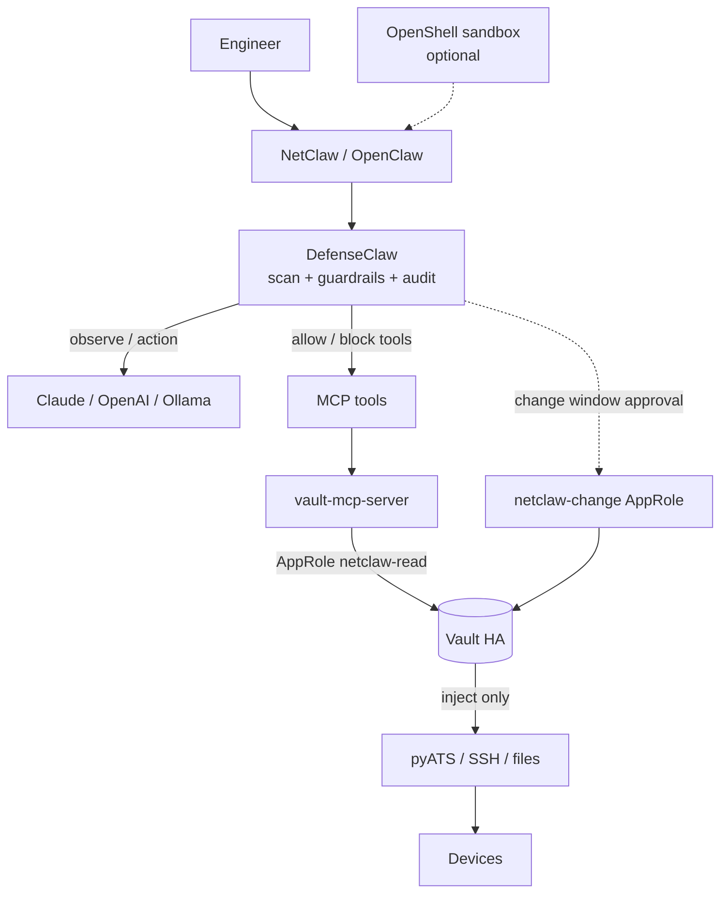

# DefenseClaw (open source) in the NetClaw design

<!-- doc-nav:start -->
> **Hub:** [Documentation home](README.md) · **4. Agent**  
> ← [NetClaw](NETCLAW.md) · [Models](MODELS.md) →
<!-- doc-nav:end -->

**DefenseClaw** ([cisco-ai-defense/defenseclaw](https://github.com/cisco-ai-defense/defenseclaw), Apache-2.0) is the open-source **security governance** layer for NetClaw / OpenClaw: scan skills and MCPs before use, inspect model and tool traffic at runtime, and export audit evidence. Pair it with **HashiCorp Vault** (secrets SoT) and optional **NVIDIA OpenShell** (sandbox isolation).

This guide fits the same production stack as the rest of this repo: GitLab CE, Ansible, NetBox, Dev Containers, Vault HA, SSH CA, Claude/OpenAI/local models.

Upstream:

- Cisco docs: [DefenseClaw documentation](https://cisco-ai-defense.github.io/defenseclaw/docs/)
- NetClaw integration notes: [automateyournetwork/netclaw `docs/DEFENSECLAW.md`](https://github.com/automateyournetwork/netclaw/blob/main/docs/DEFENSECLAW.md)
- Enable script (pinned, checksum-verified): `scripts/defenseclaw-enable.sh` in that repo

---

## 1. Where DefenseClaw sits



| Layer | Job | Not responsible for |
|-------|-----|---------------------|
| **Vault** | Hold secrets; short-lived SSH certs; audit secret *access* | Model prompt inspection |
| **vault-mcp** | Inject secrets into tools; redact chat | Blocking dangerous skills |
| **DefenseClaw** | Scan MCPs/skills; inspect LLM + tool calls; SIEM export | Storing device passwords |
| **OpenShell** (optional) | FS / network / process isolation for the agent | Secrets SoT |
| **ClearPass** | X.509 / NAC | SSH CA or agent guardrails |

**Rule:** Default NetClaw = `netclaw-read` + DefenseClaw **observe → action**. Elevate to `netclaw-change` only inside an approved change window that DefenseClaw and your ops process both allow ([NETCLAW.md](NETCLAW.md), [SECURITY.md](SECURITY.md)).

---

## 2. Production baseline

| Requirement | Expectation |
|-------------|-------------|
| **Install** | Pin a DefenseClaw **release tag**; verify `install.sh` against release `checksums.txt` (and a reviewed SHA if your org requires it) — do **not** pipe `main` into bash |
| **Connector** | OpenClaw / NetClaw (`--connector openclaw`) |
| **Guardrail mode** | Start **`observe`**; promote to **`action`** after audit review on stage |
| **Fail closed** | Unknown LLM provider domains blocked; hooks fail closed by default |
| **Vault** | AppRole + `VAULT_CACERT`; no root; no secret values in DefenseClaw config |
| **MCP registration** | Register `vault-mcp` (and other MCPs) with `defenseclaw mcp set`; scan before allow |
| **SIEM** | Ship DefenseClaw alerts + Vault audit to the same ops pipeline |
| **OpenShell** | Optional; if used, pin installer digest and allowlist Vault VIP, NetBox, GitLab, LLM endpoints |

Pin versions in [VERSIONS.md](VERSIONS.md). NetClaw’s `defenseclaw-enable.sh` is the preferred path when you run that tree; otherwise follow Cisco’s install guide with the same pin/verify discipline.

---

## 3. Install (production-shaped)

### Prerequisites

| Requirement | Minimum | Needed for |
|-------------|---------|------------|
| Python | 3.10+ | DefenseClaw CLI |
| Node.js | 20+ | OpenClaw + DefenseClaw plugin |
| curl + sha256sum | any | Pinned download verify |
| Docker | Running | OpenShell only (optional) |
| Vault VIP reachable | TLS trusted | vault-mcp from the agent host |

### Preferred: NetClaw enable script

On the NetClaw host (after NetClaw/OpenClaw is installed):

```bash
# Review scripts/defenseclaw-enable.sh in automateyournetwork/netclaw first.
export DEFENSECLAW_VERSION=1.0.4          # pin — bump via change control
export DEFENSECLAW_GUARDRAIL_MODE=observe # then action on stage
# export DEFENSECLAW_INSTALL_SHA256=...   # if your process requires a reviewed digest
# export REGISTER_MCPS=1                  # register gateway MCPs after install
./scripts/defenseclaw-enable.sh
```

The script downloads the **release** installer + checksums, refuses mismatch, runs `install.sh --yes --connector openclaw`, initializes guardrails, and sets `security.mode` to `defenseclaw` in `~/.openclaw/config/openclaw.json`.

### Manual pin + verify (no NetClaw tree)

```bash
DEFENSECLAW_VERSION=1.0.4   # pin
dir=$(mktemp -d) && chmod 700 "$dir"
base="https://github.com/cisco-ai-defense/defenseclaw/releases/download/${DEFENSECLAW_VERSION}"
curl -fsSL --proto '=https' --tlsv1.2 -o "$dir/install.sh" "$base/install.sh"
curl -fsSL --proto '=https' --tlsv1.2 -o "$dir/checksums.txt" "$base/checksums.txt"
(cd "$dir" && grep -E '[[:space:]]\*?install\.sh$' checksums.txt | sha256sum -c -) \
  && bash "$dir/install.sh" --yes --connector openclaw

defenseclaw init --connector openclaw --non-interactive --yes --scanner-mode local
defenseclaw setup guardrail --connector openclaw --mode observe --scanner-mode local \
  --detection-strategy regex_only --non-interactive --no-restart
```

Ensure `security.mode` is `defenseclaw` in **`~/.openclaw/config/openclaw.json`** (agent config — not the gateway schema file that may reject that key).

### Start the guardrail sidecar

```bash
# Durable service preferred in production (systemd user or system unit)
defenseclaw-gateway start
# Verify loopback proxy (default :4000)
ss -ltn 'sport = :4000'
openclaw gateway restart
```

### Verify

```bash
defenseclaw --version
command -v defenseclaw-gateway
ls ~/.openclaw/extensions/defenseclaw
defenseclaw-gateway status
```

---

## 4. Wire Vault MCP under DefenseClaw

Vault remains the secrets SoT ([NETCLAW.md](NETCLAW.md)). DefenseClaw must **see** and **scan** the MCP before production use.

1. Register `vault-mcp` in OpenClaw config (AppRole → short-lived `VAULT_TOKEN`).
2. Register the same MCP with DefenseClaw:

```bash
defenseclaw mcp set vault-mcp \
  --command vault-mcp-server \
  --args '[]'
# Env vars that are SecretRefs / ${VAULT_*} stay on the host — do not paste tokens into CLI args

defenseclaw mcp scan vault-mcp
```

Or use NetClaw’s helper: `python3 scripts/register-mcps-with-defenseclaw.py` (optionally `--dry-run`).

3. Confirm CodeGuard findings: no HIGH/CRITICAL before allow.
4. Tool policy for change elevation:

```bash
# Default: block elevated Vault / destructive device tools until change window
defenseclaw tool block "vault_*_write" --reason "use netclaw-change window only"
defenseclaw tool block "*_delete*" --reason "change window only"
defenseclaw tool list
```

During an approved change window: allow the specific tools, issue `netclaw-change` AppRole (or temporary token), then revoke and re-block.

Example fragments: [`../examples/defenseclaw/`](../examples/defenseclaw/).

---

## 5. LLM providers (Claude, OpenAI, local)

DefenseClaw’s proxy forwards only to **registered** provider domains — unknown domains are **fail-closed (403)**.

| Your Main model ([MODELS.md](MODELS.md)) | Action |
|------------------------------------------|--------|
| Claude / OpenAI / other built-ins | Usually covered by release registry |
| **Ollama** (local or cloud) | Register explicitly — see [LOCAL_LLM.md](LOCAL_LLM.md) |

```bash
# Example: on-prem Ollama host used as Main/Fallback
defenseclaw setup provider add --name ollama-local --domain ollama.example.local \
  --env-key OLLAMA_API_KEY --profile-id ollama-local:default --base-provider-type ollama
defenseclaw setup provider list
# Restart sidecar if live reload cannot reach it
```

Never put API keys on the `defenseclaw` command line; use env vars / host secret files already used by NetClaw.

---

## 6. Optional OpenShell sandbox

OpenShell adds container isolation around NetClaw. It is **optional**; many production Risk-style deployments run DefenseClaw on the host with systemd confinement instead.

If you enable it:

1. Review NVIDIA’s installer; pin with `OPENSHELL_INSTALL_SHA256` when using NetClaw’s enable script (`INSTALL_OPENSHELL=1`).
2. Allow outbound to: Vault VIP `:8200`, NetBox, GitLab, LLM endpoints, and required MCP hosts — **deny** arbitrary SSH from the sandbox if device access goes through a controlled bastion path.
3. Do **not** mount host Vault recovery keys, unseal material, or engineer `~/.ssh` private keys into the sandbox.

```yaml
# Sketch — adapt; apply with openshell policy set
name: netclaw
network:
  allow_outbound:
    - "vault.example.local:8200"
    - "netbox.example.local:443"
    - "gitlab.example.local:443"
    - "api.anthropic.com:443"
    - "ollama.example.local:11434"
filesystem:
  deny:
    - ~/.ssh
    - /etc/vault.d
```

---

## 7. Runtime modes and change windows

| Mode | Behavior | When |
|------|----------|------|
| **observe** | Log violations; allow execution | Initial stage cutover |
| **action** | Log **and block** | Production default after audit review |

```bash
# Promote to blocking after stage soak
defenseclaw setup guardrail --connector openclaw --mode action --scanner-mode local \
  --detection-strategy regex_only --non-interactive --no-restart
openclaw gateway restart
```

**Change window playbook (align with Vault):**

1. Ticket / CAB approval recorded.
2. DefenseClaw: allow required write tools for the window.
3. Vault: mint `netclaw-change` credentials (short TTL) — [policies/netclaw-change.hcl](../policies/netclaw-change.hcl).
4. Execute change; Vault audit + DefenseClaw alerts both show the window.
5. Revoke change AppRole secret-id / token; re-block tools; return to `netclaw-read` only.

Guardrail categories to expect: `secret`, `command`, `sensitive-path`, `c2`, `cognitive-file`, `trust-exploit` (prompt injection). Treat chat that echoes a Vault secret as an incident ([SECURITY.md](SECURITY.md)).

---

## 8. Audit and SIEM

```bash
defenseclaw alerts --limit 50
defenseclaw alerts --severity HIGH
# Export per your release’s compliance export command — ship to SIEM
```

Correlate:

| Signal | Source |
|--------|--------|
| Secret path reads / `ssh/sign` | Vault audit |
| Tool blocks, prompt injection, MCP scan fails | DefenseClaw |
| CI JWT logins | Vault + GitLab job logs |

Retain per org policy. DefenseClaw does **not** replace Vault audit for secret access.

---

## 9. Known constraints (plan for them)

- **SecretRef gateway tokens:** some DefenseClaw 1.0.x `init` paths expect a string gateway token; SecretRef objects can fail init — resolve per NetClaw/Cisco notes before enable.
- **Custom LLM domains:** must be registered or traffic is blocked (important for Ollama).
- **OpenShell ≠ required** for DefenseClaw; do not block Vault cutover waiting on sandbox if host confinement + DefenseClaw meets your control set.
- DefenseClaw is an **enforcement and evidence** layer — it does not prove an agent is risk-free; keep Vault least privilege and fail-closed consumers.

---

## 10. Validation checklist

- [ ] DefenseClaw pinned release installed; `install.sh` checksum verified
- [ ] `security.mode=defenseclaw`; OpenClaw plugin present; sidecar on loopback
- [ ] Guardrails start in **observe** on stage; **action** before prod traffic
- [ ] `vault-mcp` registered and **scanned** clean (or findings accepted)
- [ ] LLM providers used by Main/Fallback/Compaction registered (incl. Ollama if used)
- [ ] Default tools cannot exercise `netclaw-change` / destructive device ops
- [ ] Change-window drill: allow → elevate Vault role → revoke → re-block
- [ ] Alerts export to SIEM; correlated with a Vault audit test read
- [ ] No Vault tokens or device passwords in DefenseClaw git-tracked config

---

## 11. Related docs

| Topic | Doc |
|-------|-----|
| Vault MCP + AppRole | [NETCLAW.md](NETCLAW.md) |
| Model choice | [MODELS.md](MODELS.md) |
| Local LLM + provider registration | [LOCAL_LLM.md](LOCAL_LLM.md) |
| SSH CA vs ClearPass | [SSH_CA.md](SSH_CA.md) |
| Fail closed / TTLs | [SECURITY.md](SECURITY.md) |
| Delivery phase | [WORKPLAN.md](WORKPLAN.md) Phase 5 |
| All-topic checklists | [BEST_PRACTICES.md](BEST_PRACTICES.md) |

<!-- doc-footer:start -->
---

**Hub:** [Documentation home](README.md) · **Reading path:** [Design](ARCHITECTURE.md) → [Build](INSTALL.md) → [Integrate](GITLAB.md) → [Agent](NETCLAW.md) → [Reference](DIAGRAMS.md)
<!-- doc-footer:end -->
