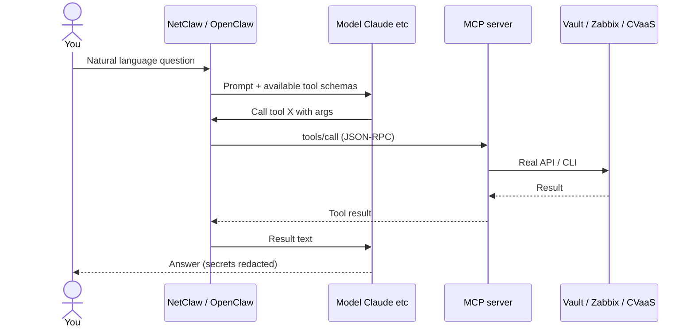
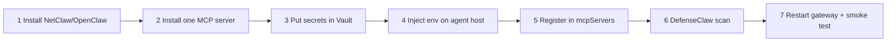

# MCP getting started (for this NetClaw stack)

<!-- doc-nav:start -->
> **Hub:** [Documentation home](README.md) · **4. Agent**  
> ← [NetBox](NETBOX.md) · [NetClaw](NETCLAW.md) →
<!-- doc-nav:end -->

**MCP** = **Model Context Protocol**. It is an open standard that lets an AI agent (here: **NetClaw / OpenClaw**) call external **tools** in a uniform way — Vault, Zabbix, CloudVision, Cloudflare, pyATS, and so on — without baking each API into the model itself.

Official intro: [modelcontextprotocol.io](https://modelcontextprotocol.io/docs/getting-started/intro)

This guide explains MCP in plain language, then how to **set up your first server** in this production Vault + DefenseClaw design.

**Full stack install order:** [STACK_INSTALL.md](STACK_INSTALL.md) (NetClaw + MCP is §7).  
Next deep dives: [NETCLAW.md](NETCLAW.md) (Vault MCP) · [DEFENSECLAW.md](DEFENSECLAW.md) (scan/guard) · [PRODUCTION_ENVIRONMENTS.md](PRODUCTION_ENVIRONMENTS.md) (your platforms)

---

## 1. What problem MCP solves

Without MCP, every integration is custom: one script for Vault, another for Zabbix, another for CVaaS. The LLM cannot reliably discover or call them.

With MCP:

1. You run (or connect to) an **MCP server** that exposes named **tools** (e.g. `list_secrets`, `get_inventory`).
2. NetClaw (the **MCP client / host**) starts or connects to that server and learns the tool list.
3. When you ask in chat — *“What critical Zabbix alarms do we have?”* — the model picks a tool, NetClaw calls the server, the server talks to Zabbix, and the result comes back into the conversation.

Think of MCP as a **USB-C port for AI tools**: one connector shape, many devices (servers).



---

## 2. Core terms

| Term | Meaning in this stack |
|------|------------------------|
| **Host / client** | NetClaw / OpenClaw gateway — runs the agent and talks to MCP servers |
| **MCP server** | A small process (or remote URL) that exposes tools — e.g. `vault-mcp-server` |
| **Tool** | One action the model can invoke — `read_secret`, `get_events`, … |
| **stdio transport** | NetClaw **spawns** the server as a child process and speaks JSON-RPC on stdin/stdout (most common locally) |
| **Remote / HTTP MCP** | NetClaw connects to a URL (e.g. some SaaS MCP endpoints) instead of spawning a binary |
| **Skills** | NetClaw wrappers/prompts that teach the agent *when* to use which MCP tools |
| **DefenseClaw** | Scans and guards MCP traffic before/while tools run ([DEFENSECLAW.md](DEFENSECLAW.md)) |

**MCP does not store secrets.** Your MCP server reads tokens from the **environment** (injected from Vault). The model should see tool *results* that are already redacted where required — never long-lived passwords in chat.

---

## 3. What you install where

| Piece | Where it lives | Example |
|-------|----------------|---------|
| OpenClaw / NetClaw | Agent host | Gateway + chat/TUI |
| MCP server binary or package | Same host (or remote URL) | `vault-mcp-server`, zabbix-mcp, … |
| Registration | OpenClaw config `mcpServers` | `command` + `args` + `env` |
| Secrets for that server | **Vault** → host env file / systemd | `VAULT_TOKEN`, `ZABBIX_TOKEN`, … |
| Governance | DefenseClaw | `defenseclaw mcp set` + `scan` |

---

## 4. Setup overview (first time)



### Step 1 — NetClaw / OpenClaw running

Follow your NetClaw install so the gateway starts and you can open the TUI/chat. You need a working Main model ([MODELS.md](MODELS.md)) before tools are useful.

### Step 2 — Install one MCP server (start with Vault)

On the agent host, install a **pinned** `vault-mcp-server` binary ([VERSIONS.md](VERSIONS.md), [NETCLAW.md](NETCLAW.md)):

```bash
command -v vault-mcp-server
# If missing: install from HashiCorp releases (pin version) — see NETCLAW.md
```

### Step 3 — Secrets in Vault (not in git)

```bash
# Already required for this stack
export VAULT_ADDR=https://vault.example.local:8200
export VAULT_CACERT=/path/to/ca.crt
# AppRole login → short-lived VAULT_TOKEN on the host (NETCLAW.md)
```

Platform tokens for later MCPs go under `secret/platform/…` ([PRODUCTION_ENVIRONMENTS.md](PRODUCTION_ENVIRONMENTS.md)).

### Step 4 — Inject env on the host

Example `/etc/netclaw/vault.env` (root-readable, **not** in GitLab):

```bash
VAULT_ADDR=https://vault.example.local:8200
VAULT_CACERT=/etc/netclaw/ca.crt
VAULT_TOKEN=…   # refreshed by timer from AppRole — never root
```

Systemd `EnvironmentFile=` or a wrapper script loads this before the gateway starts.

### Step 5 — Register the server

Add to OpenClaw / NetClaw config (path varies by install; often under `~/.openclaw/` or `config/openclaw.json`):

```json
{
  "mcpServers": {
    "vault-mcp": {
      "command": "vault-mcp-server",
      "args": [],
      "env": {
        "VAULT_ADDR": "${VAULT_ADDR}",
        "VAULT_TOKEN": "${VAULT_TOKEN}"
      }
    }
  }
}
```

Copy-paste sketch: [`../examples/openclaw-vault.json`](../examples/openclaw-vault.json).

**stdio rules that bite beginners**

- `command` must be on `PATH` (or use an absolute path).
- The server must speak MCP on **stdout** — logging goes to **stderr**. A stray `print()` on stdout breaks the client.
- Prefer `"${VAULT_TOKEN}"` style env references; **do not** paste live tokens into the JSON file in git.

Optional OpenClaw CLI (when available in your version): `openclaw mcp add` / `list` / `doctor` / `probe` — same idea, managed in OpenClaw’s MCP registry.

### Step 6 — DefenseClaw (production)

```bash
defenseclaw mcp set vault-mcp --command vault-mcp-server --args '[]'
defenseclaw mcp scan vault-mcp
```

Fix HIGH/CRITICAL findings before relying on the server in prod ([DEFENSECLAW.md](DEFENSECLAW.md)).

### Step 7 — Restart and smoke test

```bash
openclaw gateway restart   # or your NetClaw service name
```

In chat (safe prompts):

- “List Vault secret mounts.”
- “List secret *names* under `secret/network/stage` (values redacted).”

Bad: “Print the password for xr-pe-01.”

Confirm: tool appears in the agent’s tool list; Vault **audit** shows the AppRole read; chat does **not** show raw secrets.

---

## 5. Adding a second MCP (pattern)

Same steps for Zabbix, CVaaS, Cloudflare, Aruba Central, etc.:

1. Install or point at that MCP server (pin version).
2. `vault kv put secret/platform/…` with the API token.
3. Export env on the host from Vault (systemd / wrapper).
4. Add another block under `mcpServers`.
5. `defenseclaw mcp set` + `scan`.
6. Allowlist egress to that API ([PRODUCTION_ENVIRONMENTS.md](PRODUCTION_ENVIRONMENTS.md)).
7. Smoke test read-only; keep write tools blocked until a change window.

```json
"zabbix-mcp": {
  "command": "/opt/netclaw/venvs/zabbix/bin/zabbix-mcp",
  "args": [],
  "env": {
    "ZABBIX_URL": "${ZABBIX_URL}",
    "ZABBIX_TOKEN": "${ZABBIX_TOKEN}"
  }
}
```

---

## 6. Stdio vs remote MCP

| Transport | How it connects | When you use it |
|-----------|-----------------|-----------------|
| **stdio** | NetClaw starts `command` as a child process | Most on-box servers (Vault, Zabbix, pyATS, …) |
| **Remote URL** | NetClaw connects to an HTTPS MCP endpoint | Vendor-hosted MCP (when you adopt one) |

For remote MCP, auth is usually a bearer token still sourced from Vault and passed via config/env — never committed. Register the remote hostname with DefenseClaw / egress allowlists like any SaaS API.

---

## 7. How this fits your security model

| Concern | Practice |
|---------|----------|
| Secrets SoT | Vault only ([NETCLAW.md](NETCLAW.md)) |
| Who may call tools | DefenseClaw observe → action; tool allow/block |
| Writes | Change window + `netclaw-change` ([DEFENSECLAW.md](DEFENSECLAW.md)) |
| Inventory | NetBox paths/URLs — not passwords |
| Fail closed | If Vault or MCP auth fails, do not fall back to `.env` passwords in git |

MCP is the **plumbing**. Vault + DefenseClaw + NetBox are the **policy**.

---

## 8. Troubleshooting

| Symptom | Check |
|---------|--------|
| Server missing from tool list | Config JSON syntax; gateway restart; `command` on PATH |
| Server starts then dies | Run `command` by hand; read **stderr**; fix crash before re-registering |
| Auth errors to Vault/API | Host env loaded? Token TTL expired? `VAULT_CACERT` set? |
| Model never calls the tool | Skill/SOUL guidance; tool descriptions; ask explicitly once |
| Secrets appear in chat | Incident — rotate; fix redaction; tighten DefenseClaw |
| DefenseClaw blocks provider | Register custom LLM domain ([DEFENSECLAW.md](DEFENSECLAW.md)) |
| OpenShell denies API | Egress allowlist for that hostname |

---

## 9. Minimal checklist

- [ ] I can explain: host vs MCP server vs tool
- [ ] `vault-mcp` registered with env from Vault AppRole (not git)
- [ ] Gateway restarted; smoke prompts work; values redacted
- [ ] DefenseClaw scan clean for `vault-mcp`
- [ ] I know the pattern to add Zabbix/CVaaS/Cloudflare next
- [ ] Write tools stay blocked until change control

---

## 10. Related docs

| Topic | Doc |
|-------|-----|
| Vault MCP details | [NETCLAW.md](NETCLAW.md) |
| Scan / guardrails | [DEFENSECLAW.md](DEFENSECLAW.md) |
| Your controllers | [PRODUCTION_ENVIRONMENTS.md](PRODUCTION_ENVIRONMENTS.md) |
| Best practices | [BEST_PRACTICES.md](BEST_PRACTICES.md) |
| Example registration | [`../examples/openclaw-vault.json`](../examples/openclaw-vault.json) |

<!-- doc-footer:start -->
---

**Hub:** [Documentation home](README.md) · **Reading path:** [Design](ARCHITECTURE.md) → [Build](INSTALL.md) → [Integrate](GITLAB.md) → [Agent](NETCLAW.md) → [Reference](DIAGRAMS.md)
<!-- doc-footer:end -->
