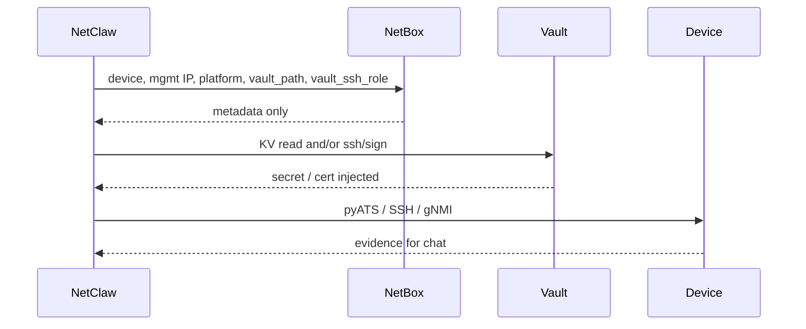

# NetBox Community + Vault

<!-- doc-nav:start -->
> **Hub:** [Documentation home](README.md) · **3. Integrate**  
> ← [Dev Containers](DEVCONTAINERS.md) · [MCP](MCP.md) →
<!-- doc-nav:end -->

NetBox remains the **inventory** source of truth. Vault remains the **secrets** source of truth.

Do **not** store device passwords in NetBox custom fields as plaintext.

---

## 1. NetBox API token in Vault

1. In NetBox: Admin → API Tokens → create a token for a dedicated service user (e.g. `svc-netclaw`).
2. Scope permissions to what automation needs (read inventory; avoid unnecessary write).
3. Prefer NetBox **v2 tokens** when available on your version.
4. Store in Vault:

```bash
vault kv put secret/platform/netbox \
  api_token="nbt_CHANGE_ME" \
  url="https://netbox.example.local"
```

GitLab / NetClaw read this path; they do not hardcode the token in repos.

---

## 2. Device → Vault path convention

Pick one approach and use it consistently.

### Option A — Naming convention (no NetBox schema change)

```
secret/network/{env}/{site}/{device_name}/credentials
```

Example: device `rtr-01`, site `dc1`, env `stage` →  
`secret/network/stage/dc1/rtr-01/credentials`

This is **Strategy A** in [PATH_LAYOUT.md](PATH_LAYOUT.md) (recommended default).

### Option B — Custom field (recommended)

Add a device (or device-role) custom field:

| Field | Type | Example |
|-------|------|---------|
| `vault_path` | Text | `network/stage/dc1/rtr-01/credentials` |

Automation reads NetBox device → `vault_path` → `vault kv get secret/<vault_path>`.

Optional fields:

- `vault_ssh_role` → e.g. `netclaw-troubleshoot`
- `credential_env` → `stage` / `prod`

---

## 3. Orb Agent / Discovery (optional)

If you use NetBox Labs Orb Agent with Vault secrets manager:

```yaml
# See examples/orb-agent-vault.yaml
orb:
  secrets_manager:
    active: vault
    sources:
      vault:
        address: "https://vault.example.local:8200"
        auth: "approle"
        auth_args:
          role_id: "${VAULT_ROLE_ID}"
          secret_id: "${VAULT_SECRET_ID}"
```

Reference secrets in policies as Vault URIs (per Orb docs), e.g. `${vault://secret/data/network/...}`.

Apply policy [`../policies/netbox-agent.hcl`](../policies/netbox-agent.hcl).

---

## 4. What NetClaw should query

Typical flow:



1. Ask NetBox (MCP/API): device, management IP, platform, `vault_path`.
2. Ask Vault MCP: read credentials or issue SSH OTP/cert for that path/role.
3. Connect with pyATS / SSH — inject secrets into the tool, never into the chat transcript.

---

## 5. Rotation

| Secret | Procedure |
|--------|-----------|
| NetBox API token | Create new token → `vault kv put` → verify NetClaw/CI → delete old NetBox token |
| Device password | Change on device → update KV → invalidate caches |
| Orb AppRole secret-id | `vault write -f auth/approle/role/.../secret-id` → redeploy agent env |

---

## 6. Checklist

- [ ] Service account in NetBox (not a human user)
- [ ] Token only in Vault
- [ ] `vault_path` convention documented for the team
- [ ] Stage device end-to-end: NetBox lookup → Vault read → login (then prod)
- [ ] Confirm Community edition plugins/fields match your NetBox version

<!-- doc-footer:start -->
---

**Hub:** [Documentation home](README.md) · **Reading path:** [Design](ARCHITECTURE.md) → [Build](INSTALL.md) → [Integrate](GITLAB.md) → [Agent](NETCLAW.md) → [Reference](DIAGRAMS.md)
<!-- doc-footer:end -->
