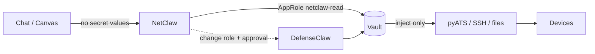

# NetClaw + HashiCorp Vault MCP

<!-- doc-nav:start -->
> **Hub:** [Documentation home](README.md) · **4. Agent**  
> ← [NetBox](NETBOX.md) · [DefenseClaw](DEFENSECLAW.md) →
<!-- doc-nav:end -->

NetClaw integrates with the official Hashicorp **vault-mcp-server** so the agent can retrieve credentials and certificates without embedding secrets in skills or chat.

For **DefenseClaw** (open-source scan + runtime guardrails + change gates), see [DEFENSECLAW.md](DEFENSECLAW.md).  
For **which LLM to use** (Claude vs OpenAI vs local), see [MODELS.md](MODELS.md).  
For **installing a local LLM** (Ollama + Qwen3), see [LOCAL_LLM.md](LOCAL_LLM.md).  
For **best practices across the whole stack**, see [BEST_PRACTICES.md](BEST_PRACTICES.md).

Upstream references:

- NetClaw Vault MCP spec: `specs/019-vault-mcp-server` in [automateyournetwork/netclaw](https://github.com/automateyournetwork/netclaw)
- Server: [hashicorp/vault-mcp-server](https://github.com/hashicorp/vault-mcp-server)

---

## 1. Security rules for agents



1. **Never** put device passwords in `SOUL.md`, skills, or git-tracked `.env`.
2. Secret **values must not appear** in chat, Canvas, or logs — inject into tools/files only.
3. Default policy = **read/troubleshoot**. Change/write uses a separate role + human approval gated by **DefenseClaw** ([DEFENSECLAW.md](DEFENSECLAW.md)).
4. Prefer SSH cert (TTL minutes) over static passwords.
5. All access must show up in Vault audit with the NetClaw AppRole identity; DefenseClaw audits model/tool traffic separately.

---

## 2. Install vault-mcp-server

On the NetClaw host:

```bash
# Example: install binary from HashiCorp releases (pin a version in prod)
# go install github.com/hashicorp/vault-mcp-server@latest

command -v vault-mcp-server
```

---

## 3. Authenticate NetClaw to Vault

### Recommended: AppRole

On Vault (once):

```bash
# From scripts/04-configure-approle.sh or INSTALL.md §7a
vault read auth/approle/role/netclaw/role-id
vault write -f auth/approle/role/netclaw/secret-id
```

On NetClaw host, store in a **root-readable env file** outside git (e.g. `/etc/netclaw/vault.env`):

```bash
VAULT_ADDR=https://vault.example.local:8200
VAULT_ROLE_ID=CHANGE_ME
VAULT_SECRET_ID=CHANGE_ME
# Optional:
# VAULT_NAMESPACE=network-ops
```

Login helper (systemd `ExecStartPre` or wrapper):

```bash
export VAULT_TOKEN=$(vault write -field=token auth/approle/login \
  role_id="$VAULT_ROLE_ID" secret_id="$VAULT_SECRET_ID")
```

> The MCP server commonly expects `VAULT_TOKEN`. Refresh the token on a schedule shorter than `token_ttl` (systemd timer or wrapper). Prefer AppRole renewal over long-lived static tokens. Never use root.

---

## 4. Register MCP in OpenClaw / NetClaw config

Example fragment (see [`../examples/openclaw-vault.json`](../examples/openclaw-vault.json)):

```json
{
  "mcpServers": {
    "vault-mcp": {
      "command": "vault-mcp-server",
      "args": [],
      "env": {
        "VAULT_ADDR": "${VAULT_ADDR}",
        "VAULT_TOKEN": "${VAULT_TOKEN}"
      }
    }
  }
}
```

Restart the NetClaw / OpenClaw gateway after registration.

---

## 5. Policies

Attach `netclaw-read` by default:

- Read `secret/data/network/stage/**` (and prod only after change control) plus platform tokens
- List metadata
- Sign SSH certs for troubleshoot role only

Use `netclaw-change` only when:

- DefenseClaw allows the write tools for an approved change window ([DEFENSECLAW.md](DEFENSECLAW.md) §7)
- Separate AppRole or temporary token elevation is issued

Policy files: [`../policies/`](../policies/). Checklist: [`../examples/defenseclaw/change-window-checklist.md`](../examples/defenseclaw/change-window-checklist.md).

---

## 6. Operational prompts (safe)

Good:

- “List secrets under `secret/network/stage` (names only).”
- “Resolve `rtr-01` from NetBox, fetch Vault creds or SSH cert, run a show interface summary.”

Bad:

- “Print the password for rtr-01.”
- “Dump all prod credentials.”

If the model attempts to display a secret, skills/MCP should redact; treat visible secrets as an incident.

---

## 7. Validation checklist

- [ ] `vault-mcp` appears in MCP server list
- [ ] List paths works; values redacted
- [ ] Stage device login via injected creds or SSH cert succeeds
- [ ] Vault audit log shows AppRole / policy name
- [ ] Prod paths denied until explicitly enabled
- [ ] Write/change requires DefenseClaw + Vault `netclaw-change` path ([DEFENSECLAW.md](DEFENSECLAW.md))

---

## 8. Transition from `.env` device passwords

NetClaw `.env.example` may show `NETCLAW_USERNAME` / `NETCLAW_PASSWORD`. For production:

1. Do not run production NetClaw with plaintext device passwords in `.env`.
2. Point skills at Vault-backed injection / SSH CA.
3. Remove static passwords from host env once Phase 5 acceptance passes ([WORKPLAN.md](WORKPLAN.md)).

<!-- doc-footer:start -->
---

**Hub:** [Documentation home](README.md) · **Reading path:** [Design](ARCHITECTURE.md) → [Build](INSTALL.md) → [Integrate](GITLAB.md) → [Agent](NETCLAW.md) → [Reference](DIAGRAMS.md)
<!-- doc-footer:end -->
