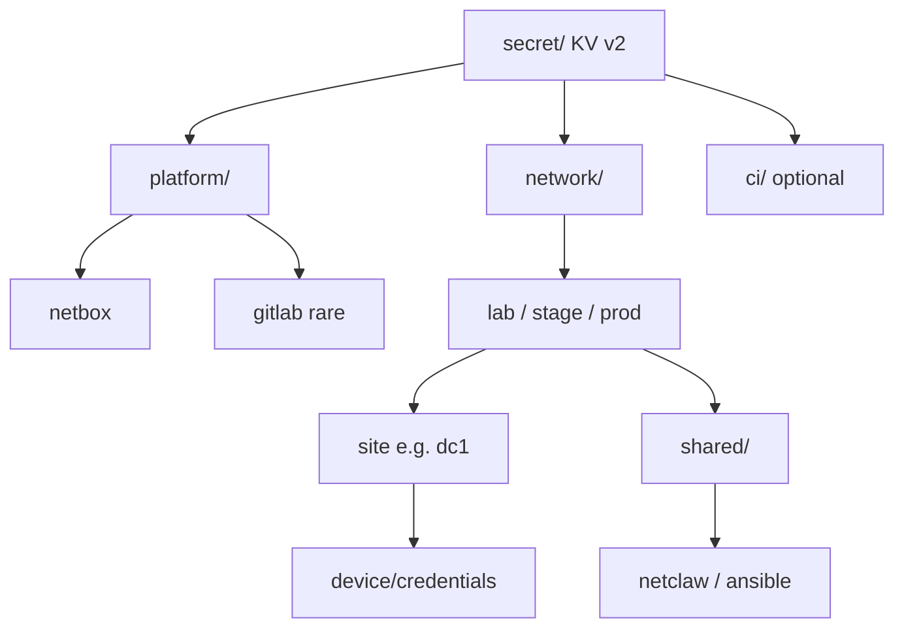
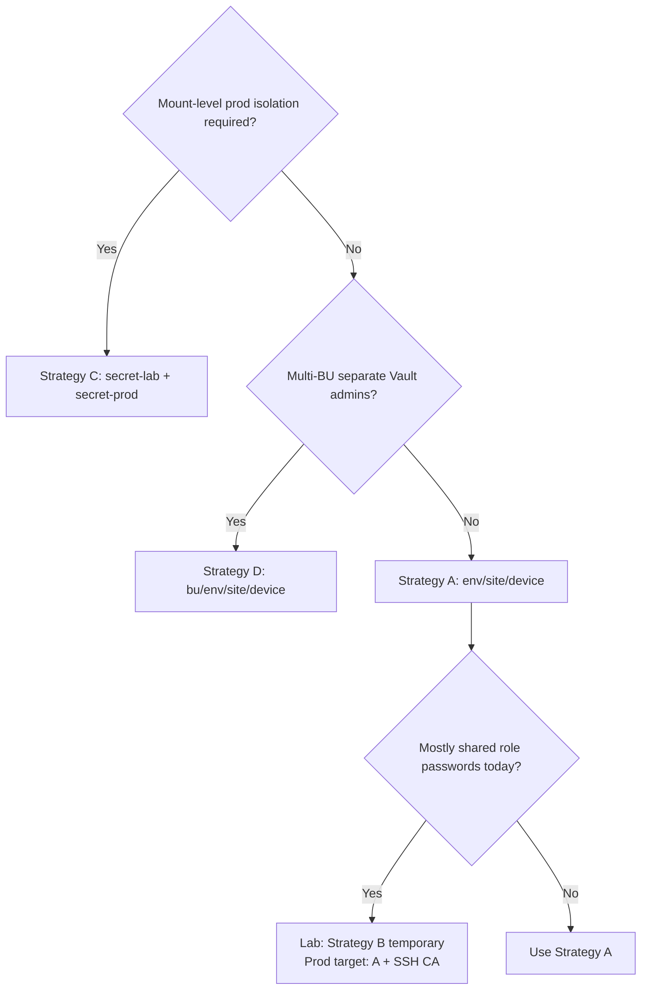

# Vault path layout strategies and designs

<!-- doc-nav:start -->
> **Hub:** [Documentation home](README.md) · **2. Build**  
> ← [Install](INSTALL.md) · [GitLab](GITLAB.md) →
<!-- doc-nav:end -->

How to organize HashiCorp Vault mounts and KV paths for network automation with **GitLab CE**, **Ansible**, **NetBox**, **Dev Containers**, and **NetClaw**.

Related: [INSTALL.md](INSTALL.md) · [SECURITY.md](SECURITY.md) · [NETBOX.md](NETBOX.md) · [GITLAB.md](GITLAB.md)

---

## Design goals

1. **Policy-friendly** — one or two path globs can grant lab read without prod.
2. **Inventory-aligned** — paths map cleanly from NetBox (site, device, env).
3. **Consumer-clear** — GitLab CI, Ansible, NetClaw, and humans resolve the same path.
4. **Rotation-safe** — changing a password updates one object; callers keep the path.
5. **Audit-readable** — logs show *what* was accessed (`…/prod/…` vs `…/lab/…`).

Secrets live in Vault. NetBox holds **inventory + path references**, not passwords.

---

## Mounts vs paths

| Layer | Example | Controls |
|-------|---------|----------|
| **Mount** (secrets engine) | `secret/` (KV v2), `ssh/`, `pki/` | Engine type, default lease, major blast radius |
| **Path inside mount** | `network/lab/dc1/rtr-01/credentials` | Fine-grained ACL via policies |
| **Fields** inside a secret | `username`, `password`, `enable_secret` | What callers read |

**Recommendation for this stack**

| Mount | Engine | Holds |
|-------|--------|--------|
| `secret/` | KV v2 | Device static creds, platform API tokens, shared lab users |
| `ssh/` | SSH | Roles for OTP / signed certs (not long-lived passwords) |
| `pki/` (optional) | PKI | Device/client certs (gNMI, mTLS) |

Prefer **one KV mount** (`secret/`) with a deep path taxonomy over many mounts per team (harder to operate) unless you need hard isolation (e.g. separate prod cluster later).

---

## Recommended taxonomy (default for this repo)



```
secret/                          # KV v2 mount
  platform/                      # Controllers & tools (not network devices)
    netbox/                      # fields: api_token, url
    gitlab/                      # rare helpers only — prefer JWT, not stored PATs
    observability/               # optional: Grafana, Splunk tokens
  network/
    {env}/                       # lab | stage | prod
      {site}/                    # NetBox site slug: dc1, edge-yyc, …
        {device}/                # NetBox device name / hostname
          credentials            # fields: username, password, enable_secret, …
        shared/                  # optional site-wide jump / RO user
          read-only
      shared/                    # optional env-wide automation identity
        netclaw                  # fields: username, password
        ansible
  ci/                            # optional: pipeline-only secrets (signing, etc.)
    {project}/
```

### Concrete examples

```bash
# Platform
vault kv put secret/platform/netbox \
  api_token="nbt_…" url="https://netbox.example.local"

# Per-device
vault kv put secret/network/lab/dc1/lab-rtr-01/credentials \
  username="netops" password="…" enable_secret="…"

# Env-wide agent identity (lab only — avoid shared prod passwords if possible)
vault kv put secret/network/lab/shared/netclaw \
  username="netclaw" password="…"
```

### Logical path consumers use

Callers usually omit the KV v2 `data/` segment; Vault CLI/`vault kv` and many libraries add it.

| Human / NetBox `vault_path` | Policy / ACL path (KV v2) |
|-----------------------------|---------------------------|
| `network/lab/dc1/lab-rtr-01/credentials` | `secret/data/network/lab/dc1/lab-rtr-01/credentials` |
| list under lab | `secret/metadata/network/lab/*` |

Always grant **both** `secret/data/…` and `secret/metadata/…` when listing or using metadata.

---

## Strategy options (choose deliberately)

### A — Env → site → device (recommended)

```
network/{env}/{site}/{device}/credentials
```

| Pros | Cons |
|------|------|
| Matches NetBox site/device | Deep trees |
| Easy `lab/*` vs `prod/*` policies | Renaming sites/devices needs path updates or aliases |
| Clear audit | — |

**Best default** for network ops + NetClaw.

### B — Env → role → shared credential

```
network/{env}/roles/{device_role}/credentials
```

Example: `network/prod/roles/spine/credentials` shared by all spines.

| Pros | Cons |
|------|------|
| Fewer secrets to rotate | Blast radius = entire role |
| Simple Ansible `group_vars` | Breaks least privilege for agents |

Use for **lab** or temporary migration; prefer per-device (A) for prod, or SSH certs.

### C — Dual mounts for hard isolation

```
secret-lab/     # KV v2
secret-prod/    # KV v2
```

| Pros | Cons |
|------|------|
| Impossible to glob across env by mistake | Two mounts, two policy styles |
| Separate backup/replication later | More ops overhead |

Use when compliance demands mount-level separation. Policies become `secret-prod/data/…` only for prod JWT roles.

### D — Tenant / VRF / business unit first

```
network/{bu}/{env}/{site}/{device}/credentials
```

| Pros | Cons |
|------|------|
| Multi-team Vault | Longer paths; NetBox custom field must include `bu` |
| Team-scoped AppRoles | Overkill for a single NetOps org |

### E — Flat ID keys (avoid as primary)

```
network/devices/{netbox_id}
```

| Pros | Cons |
|------|------|
| Stable if hostname changes | Opaque; bad for humans and audits |
| — | Still need a map in NetBox |

OK as an *alias* field (`vault_path_id`) later; keep human paths as primary.

---

## Decision guide



```
Need mount-level prod isolation for compliance?
  YES → Strategy C (secret-lab + secret-prod)
  NO  → Continue

Multiple business units with separate Vault admins?
  YES → Strategy D (bu/…)
  NO  → Strategy A (env/site/device)

Mostly shared role passwords today?
  Migrate with B in lab, target A (+ SSH engine) for prod
```

**This repository’s policies and examples assume Strategy A** on a single `secret/` mount.

---

## Field naming conventions

Keep field names stable across devices so Ansible/NetClaw templates stay generic:

| Field | Purpose |
|-------|---------|
| `username` | Login user |
| `password` | Login secret |
| `enable_secret` | Enable / become (when used) |
| `private_key` | Optional PEM (prefer SSH engine instead) |
| `api_token` | Platform tokens (NetBox, etc.) |
| `url` | Optional base URL for platforms |

Avoid inventing `pass`, `pwd`, `enable`, `secret` inconsistently.

One KV object per device credentials blob is usually enough:

```bash
vault kv put secret/network/prod/dc1/core-sw-01/credentials \
  username=netops password=… enable_secret=…
```

Splitting `…/credentials/password` as separate secrets is rarely worth it; GitLab Premium `secrets:vault` can still address a **field** inside one object.

---

## Shared credentials vs per-device

| Pattern | When | Path sketch |
|---------|------|-------------|
| Per-device user/pass | Best static model until SSH CA | `network/{env}/{site}/{device}/credentials` |
| Shared automation user | Lab / break-glass only | `network/{env}/shared/ansible` |
| NetClaw identity | Lab agent; tighten for prod | `network/{env}/shared/netclaw` |
| SSH OTP/cert role | Preferred for agents | `ssh/roles/netclaw-troubleshoot` (not under `secret/`) |

**Prod guidance:** move NetClaw/Ansible toward **SSH secrets engine** roles; keep KV for platforms and residual static device secrets.

---

## Aligning paths with NetBox

Store a custom field on the device (or role):

| Field | Example |
|-------|---------|
| `vault_path` | `network/lab/dc1/lab-rtr-01/credentials` |
| `vault_ssh_role` | `netclaw-troubleshoot` |
| `credential_env` | `lab` |

Derivation rule if you skip the custom field:

```text
network/{{ credential_env }}/{{ site.slug }}/{{ device.name }}/credentials
```

Document which rule is authoritative. Automation should prefer **`vault_path`** when set so renames are controlled.

See [NETBOX.md](NETBOX.md) and [`../examples/netbox-custom-fields.md`](../examples/netbox-custom-fields.md).

---

## Aligning paths with policies

KV v2 policy sketch for lab-only automation:

```hcl
path "secret/data/network/lab/*" {
  capabilities = ["read"]
}
path "secret/metadata/network/lab/*" {
  capabilities = ["list", "read"]
}
path "secret/data/platform/netbox" {
  capabilities = ["read"]
}
```

Prod CI role: swap `lab` → `prod` (separate role — never the same JWT role).

| Identity | Typical glob |
|----------|----------------|
| GitLab lab JWT | `secret/data/network/lab/*` |
| GitLab prod JWT | `secret/data/network/prod/*` |
| NetClaw read | `network/lab/*` + platform tokens |
| NetClaw change | same + write on lab (or separate prod-change) |
| Human OIDC (ops) | broader read; write via break-glass |

Existing files: [`../policies/`](../policies/).

**Glob tip:** `network/lab/*` does **not** match only one path segment in Vault ACL the way some systems do — Vault’s `*` matches within a segment; use `+` for any single segment and `*` for any depth depending on version/docs. Prefer explicit prefixes:

- `secret/data/network/lab/*` — common pattern used in this repo’s policies  
- Test with a non-root token before relying on production denies

---

## SSH and PKI beside KV

Do **not** store short-lived SSH certs as KV files. Use the SSH engine. X.509/NAC stays with **ClearPass Onboard** where you already operate it — see [SSH_CA.md](SSH_CA.md).

```
ssh/roles/netclaw-troubleshoot
ssh/roles/netclaw-change
pki/issue/network-devices          # optional X.509 via Vault — not a ClearPass replacement for NAC
```

KV still holds:

- Static fallback passwords during migration
- Platform API tokens
- Optional CA bootstrap material only if your process requires it (prefer generated Vault SSH CA)

---

## Anti-patterns

| Avoid | Why |
|-------|-----|
| Passwords in path names | Leaks into audit/UI |
| `secret/data/all-devices` one blob | No least privilege; painful rotation |
| Mixing env in field only (`env=prod` inside lab path) | Policies cannot isolate |
| Copy-paste prod paths under `lab/` | Accidental prod access via lab roles |
| Per-engineer personal paths for shared automation | Unauditable; breaks CI |
| Storing GitLab PATs when JWT works | Long-lived CI credentials |
| Different field names per vendor | Breaks generic playbooks |

---

## Migration patterns

### From Ansible Vault / group_vars

1. Inventory each `vault_*` variable → choose Strategy A path.
2. Write KV objects; keep Ansible Vault as fallback briefly ([ANSIBLE.md](ANSIBLE.md)).
3. Point `device_cred_path` at `network/{{ env }}/{{ site }}/{{ inventory_hostname }}/credentials`.
4. Remove encrypted files after lab + one prod pilot.

### From “one shared enable password”

1. Put shared secret at `network/{env}/shared/legacy-enable` temporarily.
2. Issue per-device credentials or SSH CA.
3. Delete shared path; revoke policies that allowed it.

### Renaming a device or site

1. Write new path; update NetBox `vault_path`.
2. Dual-read in automation if needed.
3. Soft-delete old KV version; tidy metadata later.

---

## Layout cheat sheet

```
# Platforms
secret/platform/netbox                         # api_token, url

# Devices (Strategy A)
secret/network/lab/dc1/lab-rtr-01/credentials
secret/network/prod/dc1/core-sw-01/credentials

# Shared lab identities
secret/network/lab/shared/netclaw
secret/network/lab/shared/ansible

# SSH engine (not KV)
ssh/roles/netclaw-troubleshoot
ssh/roles/netclaw-change
```

Seed samples: [`../scripts/03-write-sample-secrets.sh`](../scripts/03-write-sample-secrets.sh) · diagram notes: [`../examples/path-layout/`](../examples/path-layout/)

---

## Acceptance checklist

- [ ] Written standard: Strategy A (or C/D if chosen) documented for the team
- [ ] `lab` / `stage` / `prod` segments enforced in policies (separate JWT/AppRoles)
- [ ] NetBox `vault_path` (or documented derivation) matches Vault
- [ ] Field names standardized (`username` / `password` / `enable_secret`)
- [ ] Platform tokens under `secret/platform/…`, not under device trees
- [ ] SSH short-lived access planned under `ssh/roles/…`
- [ ] No prod secrets readable by lab CI or default NetClaw read role

<!-- doc-footer:start -->
---

**Hub:** [Documentation home](README.md) · **Reading path:** [Design](ARCHITECTURE.md) → [Build](INSTALL.md) → [Integrate](GITLAB.md) → [Agent](NETCLAW.md) → [Reference](DIAGRAMS.md)
<!-- doc-footer:end -->
