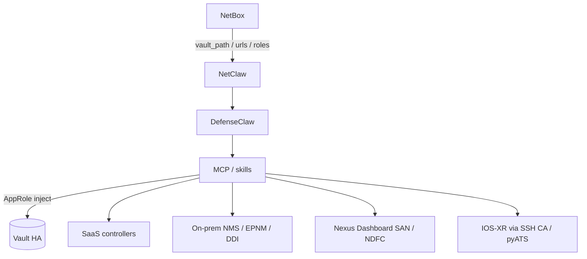
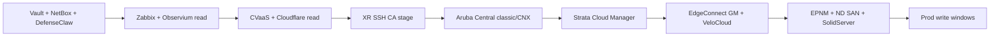

# Connecting NetClaw to production environments

<!-- doc-nav:start -->
> **Hub:** [Documentation home](README.md) · **4. Agent**  
> ← [SSH CA](SSH_CA.md) · [Diagrams](DIAGRAMS.md) →
<!-- doc-nav:end -->

How NetClaw reaches **your** production controllers, NMS, DDI, edge, SAN (Nexus Dashboard), and IOS-XR devices — with **Vault** as secrets SoT, **NetBox** as inventory, and **DefenseClaw** scanning every MCP.

Upstream NetClaw already ships first-class MCP/skills for some of these (CloudVision, Cloudflare, Zabbix, Prisma/SASE-style Palo Alto APIs, pyATS/SSH). Others use the same pattern: **API token in Vault → MCP or skill → DefenseClaw register/scan → stage then prod**.

**Install these after the core stack:** [STACK_INSTALL.md](STACK_INSTALL.md) §10.  
Related: [MCP.md](MCP.md) · [NETCLAW.md](NETCLAW.md) · [DEFENSECLAW.md](DEFENSECLAW.md) · [PATH_LAYOUT.md](PATH_LAYOUT.md) · [SSH_CA.md](SSH_CA.md) · [BEST_PRACTICES.md](BEST_PRACTICES.md)

---

## 1. Connection model (all platforms)



| Layer | Rule |
|-------|------|
| **Secrets** | API tokens, client secrets, SSH material → Vault only (`secret/platform/…` or device paths) |
| **Inventory** | Hostnames, tenants, org IDs, `vault_path` → NetBox (no passwords) |
| **Agent** | NetClaw reads Vault via AppRole; never commits tokens to git |
| **Governance** | Every MCP registered + scanned in DefenseClaw; writes gated |
| **Cutover** | Enable **stage** (or read-only prod) first; promote after audit soak |

**Do not** put production tokens in `.env` committed to GitLab. Inject from Vault into the NetClaw host env / systemd unit / MCP `env` that references `${…}` only.

---

## 2. Platform matrix (your estate)

| # | Environment | Typical access | NetClaw path | Vault path (Strategy A) | Notes |
|---|-------------|----------------|--------------|-------------------------|--------|
| 1 | **Palo Alto Strata Cloud Manager** | SaaS API / service account | MCP or PAN SASE-family skills; extend if SCM-specific API | `secret/platform/paloalto/strata-cloud-manager` | Prefer read-only service account first |
| 2 | **Arista CVaaS** (CloudVision as a Service) | Service account token | Built-in **arista-cvp** MCP/skills | `secret/platform/arista/cvaas` | `CVP` + `CVPTOKEN` pattern |
| 3 | **VeloCloud Manager (SaaS)** | Orchestrator API token / OAuth | Custom/community MCP or REST skill until native | `secret/platform/velocloud/manager` | SD-WAN orchestrator (SaaS) |
| 4 | **Cisco EPNM** | On-prem HTTPS API + user/pass or token | REST skill / custom MCP; devices still via SSH/pyATS | `secret/platform/cisco/epnm` | Prefer dedicated API user; TLS to EPNM |
| 5 | **Zabbix** | API token | Built-in / vendored **zabbix-mcp** (NetClaw spec 083) | `secret/platform/zabbix` | Token not password; API blacklist for writes |
| 6 | **Observium** | API / auth token or user | Custom MCP or read-only REST skill | `secret/platform/observium` | Often paired with Zabbix for NMS |
| 7 | **Aruba Central** (GreenLake) — **classic + CNX MCP** | Central API / MCP | Official or org **Aruba Central MCP** (classic & CNX) | `secret/platform/aruba/central-classic` · `…/central-cnx` | Separate Vault objects per MCP surface |
| 8 | **Cloudflare Enterprise** | API token + account/zone | Built-in **cloudflare-*** MCP/skills | `secret/platform/cloudflare` | Scoped token (DNS / ZT / WAF as needed) |
| 9 | **Cisco IOS-XR** (direct SSH) | SSH (+ Vault SSH CA) | **pyATS** / multivendor CLI + SSH CA | `secret/network/{env}/{site}/{device}/credentials` + `ssh/sign/…` | Prefer CA over static TACACS password |
| 10 | **EfficientIP SolidServer (DDI)** | API key / user | Custom MCP or REST skill (DNS/DHCP/IPAM) | `secret/platform/efficientip/solidserver` | Align zones/subnets with NetBox |
| 11 | **Aruba EdgeConnect Global Manager (SaaS)** | Orchestrator API | Custom/community MCP or REST skill | `secret/platform/aruba/edgeconnect-gm` | SD-WAN; read-only first |
| 12 | **Cisco Nexus Dashboard — SAN** (NDFC SAN Controller) | On-prem ND login / API key + NDFC SAN REST | Custom MCP or REST skill over ND + SAN APIs | `secret/platform/cisco/nexus-dashboard-san` | Prefer API key for automation; read-only first |

Examples: [`../examples/production-envs/`](../examples/production-envs/).

---

## 3. Shared cutover steps (every platform)

1. **Create a least-privilege identity** in the vendor UI (read-only where possible).
2. **Store secrets in Vault** under `secret/platform/…` (controllers) or `secret/network/…` (devices).
3. **Record non-secret metadata in NetBox** (URL, org/tenant ID, `vault_path`, tags).
4. **Register MCP** in OpenClaw/NetClaw config with env from Vault-injected host files.
5. **`defenseclaw mcp set` + `defenseclaw mcp scan`** — fix HIGH/CRITICAL before prod ([DEFENSECLAW.md](DEFENSECLAW.md)).
6. **Allow outbound** from NetClaw/OpenShell to the SaaS/API endpoint (and Vault VIP).
7. **Smoke test on stage** (or read-only prod scope); confirm Vault audit + DefenseClaw alerts.
8. **Gate writes** with DefenseClaw tool blocks + change window + `netclaw-change` if the MCP can mutate state.

---

## 4. Vault path conventions (controllers)

Extend Strategy A platform tree ([PATH_LAYOUT.md](PATH_LAYOUT.md)):

```
secret/platform/
  netbox/
  paloalto/strata-cloud-manager     # client_id, client_secret, tsg_id, region, base_url
  arista/cvaas                      # host, token
  velocloud/manager                 # base_url, api_token (or oauth fields)
  cisco/epnm                        # base_url, username, password_or_token
  cisco/nexus-dashboard-san         # base_url, api_key (preferred) or user/pass + domain
  zabbix                            # url, api_token
  observium                         # url, api_token
  aruba/central-classic             # base_url, client_id, client_secret, customer_id, …
  aruba/central-cnx                 # CNX MCP credentials (separate object)
  aruba/edgeconnect-gm              # base_url, api_token
  cloudflare                        # api_token, account_id, zone_id (optional)
  efficientip/solidserver           # base_url, api_key or user/pass
```

```bash
# Examples — replace values via controlled process; never commit real secrets
vault kv put secret/platform/arista/cvaas \
  host="www.arista.io" token="CHANGE_ME"

vault kv put secret/platform/zabbix \
  url="https://zabbix.example.local" api_token="CHANGE_ME"

vault kv put secret/platform/cloudflare \
  api_token="CHANGE_ME" account_id="CHANGE_ME" zone_id="CHANGE_ME"

vault kv put secret/platform/paloalto/strata-cloud-manager \
  client_id="CHANGE_ME" client_secret="CHANGE_ME" \
  tsg_id="CHANGE_ME" region="americas" \
  base_url="https://api.strata.paloaltonetworks.com"

vault kv put secret/platform/cisco/nexus-dashboard-san \
  base_url="https://nd.example.local" \
  api_key="CHANGE_ME" \
  domain="DefaultAuth" \
  verify_tls="true"
```

Grant NetClaw **read** on only the platform paths it needs (split AppRoles later if blast radius demands it).

---

## 5. Per-platform notes

### 5.1 Palo Alto Strata Cloud Manager

- Use a **service account** scoped to required tenants/folders; start **read-only**.
- NetClaw’s Palo Alto / Prisma SASE-family integrations use `PAN_CLIENT_ID` / `PAN_CLIENT_SECRET` / `PAN_TSG_ID` / `PAN_REGION` — map SCM credentials into Vault and inject the same way; add or adjust MCP if your SCM API surface differs from Prisma SD-WAN skills.
- DefenseClaw: register the PAN MCP; block write tools until change control.
- NetBox: tag firewalls/Prisma sites with `controller=strata-cloud-manager` and `vault_path` for any device-local secrets.

### 5.2 Arista CVaaS (CloudVision)

- Native NetClaw **arista-cvp** skills: inventory, events, connectivity monitor, tags.
- Vault: `host` (e.g. `www.arista.io` without scheme) + service account `token`.
- Env injection: `CVP`, `CVPTOKEN` from Vault — not git.
- Cross-check EOS inventory with NetBox; use ANTA/pyATS for device-plane validation when needed.
- Tag creation modifies CVP — gate with DefenseClaw + ITSM/change window.

### 5.3 VeloCloud Manager (SaaS)

- Orchestrator API: store `base_url` + API token (or OAuth client) in Vault.
- Until a first-class NetClaw MCP exists in your tree: thin REST MCP or skill that only reads edges/links/alerts; register under DefenseClaw.
- NetBox: SD-WAN edges as devices/VM with `controller=velocloud` and site mapping.
- Allowlist orchestrator hostname in OpenShell egress policy.

### 5.4 Cisco EPNM

- On-prem: TLS to `https://epnm.example.local`; put CA in system trust / `REQUESTS_CA_BUNDLE`.
- Vault: URL + dedicated API user (not shared human admin).
- Use EPNM for inventory/alarms/config archive references; **device changes** still prefer SSH CA / pyATS with DefenseClaw gates.
- Do not store device enable secrets in EPNM if Vault is SoT — keep EPNM as manager of record for what it owns, credentials in Vault.

### 5.5 Zabbix

- NetClaw **zabbix-mcp**: set `ZABBIX_URL` + `ZABBIX_TOKEN` (API token, not user password).
- Use `ZABBIX_API_BLACKLIST` (or equivalent) to deny mutating API methods in production.
- Vault path `secret/platform/zabbix`; rotate tokens on the security calendar.
- Correlate Zabbix host names with NetBox device names.

### 5.6 Observium

- Prefer API token over interactive user password.
- Read-only MCP/skill for device status, ports, alerts; no config push via Observium.
- Vault `secret/platform/observium`; same DefenseClaw scan pattern as Zabbix.

### 5.7 Aruba Central (GreenLake) — classic & CNX MCP

- Run **two** credential objects and, if needed, two MCP registrations: `central-classic` and `central-cnx`.
- Store GreenLake/Central client credentials in Vault; never in MCP args.
- Follow HPE/Aruba MCP docs for classic vs CNX endpoints; pin MCP versions ([VERSIONS.md](VERSIONS.md)).
- Scan both MCPs with DefenseClaw; allowlist `*.central.arubanetworks.com` / GreenLake API hosts as required.
- Device onboarding metadata in NetBox; WLAN/gateway secrets still in Vault if not Central-only.

### 5.8 Cloudflare Enterprise

- Native NetClaw Cloudflare MCP/skills: DNS, Zero Trust, analytics, Workers, security.
- Vault: scoped **API token** (least privilege per skill set) + `account_id` (+ optional default `zone_id`).
- Prefer separate tokens for DNS vs Zero Trust vs WAF if blast radius matters.
- Workers deploy / firewall mutations = change window only.

### 5.9 Cisco IOS-XR (direct SSH)

- Primary path: **Vault SSH CA** → bastion or XR if certs supported; else bastion + XR AAA ([SSH_CA.md](SSH_CA.md)).
- NetClaw: **pyATS** / multivendor CLI MCP with testbed entries resolved from NetBox + Vault inject.
- Per-device KV: `secret/network/prod/{site}/{xr-hostname}/credentials` only as residual; prefer certs.
- NetBox: `platform=iosxr`, `vault_path`, `vault_ssh_role=netclaw-troubleshoot`.
- gNMI optional later (`GNMI_TARGETS`); credentials still from Vault.

### 5.10 EfficientIP SolidServer (DDI)

- Vault: API key or service user for SolidServer.
- Skills: read DNS zones, DHCP scopes, IPAM allocations; writes (create record, allocate IP) require change window.
- Keep NetBox IPAM and SolidServer aligned — document which is authoritative for each object class (e.g. NetBox DCIM + SolidServer DNS).
- Allowlist SolidServer URL from NetClaw host.

### 5.11 Aruba EdgeConnect Global Manager (SaaS)

- SaaS orchestrator for EdgeConnect SD-WAN: API token in Vault.
- Read-only first: sites, appliances, overlays, alarms.
- NetBox: tag EC appliances `controller=edgeconnect-gm`.
- DefenseClaw + egress allowlist for Global Manager API hostname.

### 5.12 Cisco Nexus Dashboard for SAN (NDFC SAN Controller)

Nexus Dashboard (ND) hosts the **SAN Controller** service (NDFC SAN). NetClaw should treat this as an **on-prem controller plane** for MDS/SAN fabrics — inventory, VSAN/zoning visibility, alarms — not as a place to store device TACACS passwords (those stay in Vault).

**Auth (Cisco DevNet pattern)**

- Prefer an **API key** on a dedicated ND local automation user (better for scripts/agents than interactive login).
- Alternative: `POST https://<nd-node>/login` with `userName` / `userPasswd` / `domain`, then use the returned JWT as `Authorization: Bearer …` (tokens expire — default often ~20 minutes; refresh via `/refresh` or re-login).
- NDFC SAN REST shares the ND gateway; SAN endpoints live under the Fabric Controller API prefix, e.g. `https://<nd-node>/appcenter/cisco/ndfc/api/v1/…` (see [NDFC getting started](https://developer.cisco.com/docs/nexus-dashboard-fabric-controller/latest/getting-started/) and [API reference (SAN)](https://developer.cisco.com/docs/nexus-dashboard-fabric-controller/latest/api-reference-san/)).
- In-product docs: `https://<nd-node>/apidocs/`.

**Vault**

```bash
vault kv put secret/platform/cisco/nexus-dashboard-san \
  base_url="https://nd.example.local" \
  api_key="CHANGE_ME" \
  domain="DefaultAuth" \
  verify_tls="true"
```

If you must use user/password instead of API key, store `username` / `password` / `domain` in the same path — still inject via host env, never git. Trust the ND TLS CA on the NetClaw host (`REQUESTS_CA_BUNDLE` / system trust); do not use `verify_tls=false` in production.

**NetClaw / MCP**

- Until a first-class NetClaw MCP exists in your tree: thin **read-only** REST MCP/skill that lists fabrics, switches, VSAN/zone summaries, and alarms via ND + NDFC SAN APIs.
- Register as e.g. `nexus-dashboard-san-mcp`; `defenseclaw mcp set` + `scan`.
- Gate any zoning / config POST/DELETE behind DefenseClaw tool blocks + change window + `netclaw-change`.
- RBAC lives in Nexus Dashboard (security domains / roles) — grant NetClaw a **read-focused** role on SAN fabrics only.

**NetBox**

- Tag SAN switches / directors: `controller=nexus-dashboard-san`, `controller_url=https://nd.example.local`, `vault_path=platform/cisco/nexus-dashboard-san`.
- Optional: custom field `san_fabric` matching the ND/NDFC fabric or site name.
- Cross-check MDS inventory in NetBox against ND; device SSH (if ever needed) still uses Vault paths / SSH CA separately.

**Egress**

- Allowlist `nd.example.local:443` (and any ND cluster VIPs) from the NetClaw host / OpenShell policy.

---

## 6. DefenseClaw & egress

```bash
# After each MCP is configured
defenseclaw mcp set zabbix-mcp --command …   # per your install
defenseclaw mcp scan zabbix-mcp
# Repeat for cvaas, cloudflare, aruba-central-*, nexus-dashboard-san, custom REST MCPs, vault-mcp, pyats-mcp
```

OpenShell / host firewall allowlist (sketch):

| Destination | Purpose |
|-------------|---------|
| `vault.example.local:8200` | Secrets |
| `netbox.example.local:443` | Inventory |
| CVaaS / Strata / Central / EdgeConnect / VeloCloud / Cloudflare API hosts | SaaS |
| `epnm.example.local`, `nd.example.local` (Nexus Dashboard SAN), `zabbix.example.local`, `observium.example.local`, SolidServer | On-prem |
| XR / bastion management prefixes | SSH |

Deny arbitrary internet SSH from the agent sandbox when possible; use bastions.

---

## 7. Suggested enablement order



1. Platform secrets in Vault + NetBox metadata  
2. NMS read (Zabbix, Observium)  
3. Cloud controllers read (CVaaS, Cloudflare)  
4. IOS-XR stage via SSH CA  
5. Aruba Central MCPs (classic, then CNX)  
6. Strata Cloud Manager  
7. EdgeConnect GM + VeloCloud  
8. EPNM + **Nexus Dashboard SAN** + EfficientIP  
9. Carefully open write tools under change control (including SAN zoning)  

---

## 8. Validation checklist

- [ ] Each platform has a Vault object under `secret/platform/…` (devices under `secret/network/…`)
- [ ] NetBox has URL / IDs / `vault_path` / controller tags — no passwords
- [ ] MCP or skill registered; DefenseClaw scan clean
- [ ] Stage (or read-only) smoke test succeeded; secrets not echoed in chat
- [ ] Vault audit shows AppRole reads; DefenseClaw shows tool allow/deny
- [ ] Write-capable tools blocked by default; change-window drill documented
- [ ] Egress allowlist includes only required API/SSH destinations
- [ ] Pins recorded for MCP server versions ([VERSIONS.md](VERSIONS.md))

---

## 9. Related docs

| Topic | Doc |
|-------|-----|
| Vault MCP / AppRole | [NETCLAW.md](NETCLAW.md) |
| Scan / guardrails | [DEFENSECLAW.md](DEFENSECLAW.md) |
| XR SSH / bastions | [SSH_CA.md](SSH_CA.md) |
| Path taxonomy | [PATH_LAYOUT.md](PATH_LAYOUT.md) |
| Checklists | [BEST_PRACTICES.md](BEST_PRACTICES.md) |
| Snippets | [`../examples/production-envs/`](../examples/production-envs/) |

<!-- doc-footer:start -->
---

**Hub:** [Documentation home](README.md) · **Reading path:** [Design](ARCHITECTURE.md) → [Build](INSTALL.md) → [Integrate](GITLAB.md) → [Agent](NETCLAW.md) → [Reference](DIAGRAMS.md)
<!-- doc-footer:end -->
