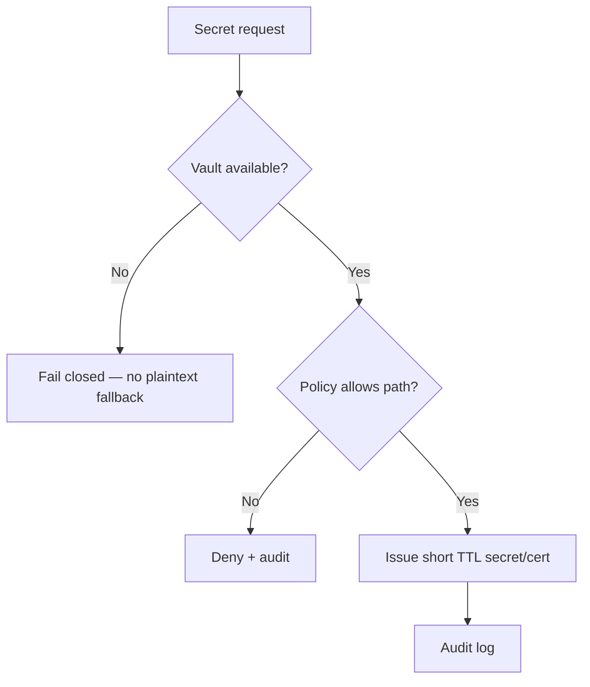

# Security controls

<!-- doc-nav:start -->
> **Hub:** [Documentation home](README.md) · **1. Design**  
> ← [Architecture](ARCHITECTURE.md) · [Workplan](WORKPLAN.md) →
<!-- doc-nav:end -->

## Principles



1. **Fail closed** — if Vault is unavailable, do not fall back to plaintext credential files in production.
2. **Least privilege** — separate policies for CI lab, CI prod, NetClaw read, NetClaw change, NetBox agent.
3. **Short TTL** — tokens hours or less; SSH certs/OTP minutes.
4. **No secret in git** — only paths, role names, and non-secret URLs.
5. **Audit everything** — file/socket audit device always on.

---

## Path layout

Prefer `network/{env}/{site}/{device}/credentials` so policies can deny `prod/` independently of `lab/`. Full strategies: [PATH_LAYOUT.md](PATH_LAYOUT.md).

## KV v2 policy paths

For KV v2, grant both data and metadata:

```hcl
path "secret/data/network/lab/*" {
  capabilities = ["read"]
}
path "secret/metadata/network/lab/*" {
  capabilities = ["list", "read"]
}
```

Writes require `create` / `update` on `secret/data/...` and should be rare for agents.

---

## Recommended TTLs

| Credential | TTL |
|------------|-----|
| GitLab JWT Vault token | 15m |
| NetClaw AppRole token | 1h (max 4h) |
| AppRole secret-id | 24h–7d (rotate often) |
| SSH OTP/cert (Vault SSH CA) | 15–30m |
| Human admin token | 1h + MFA |

---

## Root token & unseal keys

- After bootstrap: create admin identity, **revoke root** or print-once offline escrow.
- Unseal key shares: split custody (3 of 5); never in Git, NetBox, or Vault itself.
- Document break-glass in an offline runbook.

---

## GitLab guardrails

- Bound JWT claims on `project_path` and `ref_protected`
- Production role ≠ lab role
- Protected variables + protected runners for prod
- MR pipelines: inventory read only, no `prod/` secrets
- On **Community Edition**, use JWT + Vault CLI (no `secrets:vault`); do not rely on auto-masking — keep secrets out of logs ([GITLAB.md](GITLAB.md))

## Ansible & Dev Container guardrails

- Prefer HashiCorp Vault lookups over Ansible Vault files for team secrets
- `no_log: true` on tasks that handle passwords / enable / tokens
- Dev Containers: secrets only via `remoteEnv` / token mount — never `Dockerfile ENV` or committed `.env`
- CI JWT identity ≠ human OIDC identity (separate audit principals)
- No plaintext fallback (`default(old_vault_var)`) left in prod playbooks after cutover

---

## NetClaw guardrails

- Default AppRole → `netclaw-read` only
- Elevate to `netclaw-change` via approval workflow
- MCP must redact secret values
- Sandbox (OpenShell / DefenseClaw) for skill execution
- Deny `secret/data/network/prod/**` until explicitly enabled

---

## Audit & monitoring

Watch for:

- Sudden spike in `secret/data/network/prod` reads
- Auth failures from Runners or NetClaw host
- Use of root token
- Seal status / storage errors
- Audit log disk filling

Retain audit logs per your org policy (export off-box).

---

## Rotation calendar (starter)

| Item | Cadence |
|------|---------|
| NetBox API token | 90 days |
| NetClaw secret-id | 30 days |
| Device shared passwords (until SSH CA) | 90 days |
| TLS cert for Vault | per CA lifetime |
| Policy review | quarterly |

---

## Incident response (credential leak)

1. Revoke Vault token / secret-id / rotate KV version.
2. Rotate device password or invalidate SSH certs.
3. Review audit log for blast radius.
4. Rotate NetBox token if exposed.
5. Treat chat transcripts that echoed secrets as compromised artifacts.

<!-- doc-footer:start -->
---

**Hub:** [Documentation home](README.md) · **Reading path:** [Design](ARCHITECTURE.md) → [Build](INSTALL.md) → [Integrate](GITLAB.md) → [Agent](NETCLAW.md) → [Reference](DIAGRAMS.md)
<!-- doc-footer:end -->
