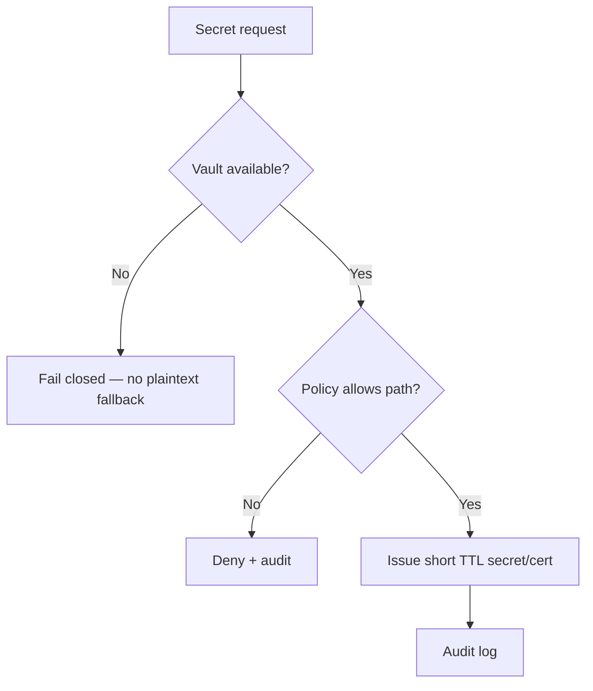

# Security controls

<!-- doc-nav:start -->
> **Hub:** [Documentation home](README.md) · **1. Design**  
> ← [Architecture](ARCHITECTURE.md) · [Workplan](WORKPLAN.md) →
<!-- doc-nav:end -->

Production controls for Vault as secrets SoT. Pair with [INSTALL.md](INSTALL.md) (HA, TLS, auto-unseal) and [PATH_LAYOUT.md](PATH_LAYOUT.md).

## Principles



1. **Fail closed** — if Vault is unavailable, do not fall back to plaintext credential files.
2. **Least privilege** — separate policies for CI stage, CI prod, NetClaw read, NetClaw change, NetBox agent.
3. **Short TTL** — tokens hours or less; SSH certs minutes.
4. **No secret in git** — only paths, role names, and non-secret URLs.
5. **Audit everything** — file/socket audit always on; ship off-box to SIEM.
6. **HA + auto-unseal** — production cluster must survive node loss and reboot without human Shamir unseal for day-2.

---

## Platform hardening

| Control | Production expectation |
|---------|------------------------|
| Cluster | 3+ Raft voters behind TLS VIP |
| Listener | TLS from enterprise/internal CA; clients use `VAULT_CACERT` |
| Unseal | Auto-unseal (KMS / HSM / Transit); recovery keys in multi-party escrow |
| Root token | Bootstrap only; revoke after admin identity exists |
| Snapshots | Scheduled Raft snapshots; restore drill before cutover |
| Telemetry | Prometheus / metrics + seal and peer alerts |
| UI | Optional; restrict to admin networks if enabled |

Never run `-dev`, `tls_disable`, or `VAULT_SKIP_VERIFY` with real secrets.

---

## Path layout

Prefer `network/{env}/{site}/{device}/credentials` so policies deny `prod/` independently of `stage/`. Full strategies: [PATH_LAYOUT.md](PATH_LAYOUT.md).

## KV v2 policy paths

```hcl
path "secret/data/network/stage/*" {
  capabilities = ["read"]
}
path "secret/metadata/network/stage/*" {
  capabilities = ["list", "read"]
}
```

Prod CI uses a **separate** policy (`gitlab-ci-prod`) bound only to protected-branch JWT roles. Writes require `create` / `update` and should be rare for agents.

---

## Recommended TTLs

| Credential | TTL |
|------------|-----|
| GitLab JWT Vault token | 15m |
| NetClaw AppRole token | 1h (max 4h) |
| AppRole secret-id | ≤ 7d (rotate on calendar) |
| SSH cert (Vault SSH CA) | 15–30m |
| Human admin token | 1h + MFA |

---

## Root token, recovery keys, auto-unseal

- After bootstrap: create admin identity (OIDC + MFA preferred), **revoke root**.
- Recovery keys: split custody; never in Git, NetBox, or the Vault cluster itself.
- Auto-unseal credentials (KMS roles, Transit token): treat as crown jewels; rotate per platform policy.
- Document break-glass seal/recovery offline.

---

## GitLab guardrails

- Bound JWT claims on `project_path`, `ref_protected`, and environment
- Production JWT role ≠ stage role (separate Vault policies)
- Protected runners for prod jobs
- MR pipelines: no `prod/` secrets
- On **Community Edition**, use JWT + Vault CLI; scrub logs — no Premium auto-mask ([GITLAB.md](GITLAB.md))

## Ansible & Dev Container guardrails

- Prefer HashiCorp Vault lookups over Ansible Vault files for team secrets
- `no_log: true` on tasks that handle passwords / enable / tokens
- Dev Containers: secrets only via `remoteEnv` / OIDC — never `Dockerfile ENV` or committed `.env`
- CI JWT identity ≠ human OIDC identity
- No plaintext fallback left in prod playbooks after cutover

---

## NetClaw + DefenseClaw guardrails

- Default AppRole → `netclaw-read` (stage first; prod paths explicitly enabled)
- **DefenseClaw** (open source): scan MCPs/skills; inspect LLM + tool calls; fail closed on unknown providers — [DEFENSECLAW.md](DEFENSECLAW.md)
- Elevate to `netclaw-change` only inside an approved change window (DefenseClaw tool allow + short-lived Vault role)
- MCP must redact secret values; Vault audit ≠ DefenseClaw audit — retain both
- Optional OpenShell sandbox for FS/network isolation; not a substitute for Vault least privilege
- Prefer SSH CA sign over shared static passwords in prod

---

## Audit & monitoring

Watch for:

- Spike in `secret/data/network/prod` reads
- Auth failures from Runners or NetClaw host
- Use of root or recovery operations
- Seal status / Raft peer loss / storage errors
- Audit log disk filling

Retain and ship audit logs per org policy.

---

## Rotation calendar (starter)

| Item | Cadence |
|------|---------|
| NetBox API token | 90 days |
| NetClaw secret-id | 30 days |
| Device static passwords (until SSH CA) | 90 days |
| Vault TLS cert | per CA lifetime |
| Policy review | quarterly |
| Raft snapshot restore drill | at least annually (prefer quarterly) |

---

## Incident response (credential leak)

1. Revoke Vault token / secret-id / rotate KV version.
2. Rotate device password or invalidate SSH certs (role TTL / CRLs as applicable).
3. Review audit log for blast radius.
4. Rotate NetBox token if exposed.
5. Treat chat transcripts that echoed secrets as compromised artifacts.

<!-- doc-footer:start -->
---

**Hub:** [Documentation home](README.md) · **Reading path:** [Design](ARCHITECTURE.md) → [Build](INSTALL.md) → [Integrate](GITLAB.md) → [Agent](NETCLAW.md) → [Reference](DIAGRAMS.md)
<!-- doc-footer:end -->
