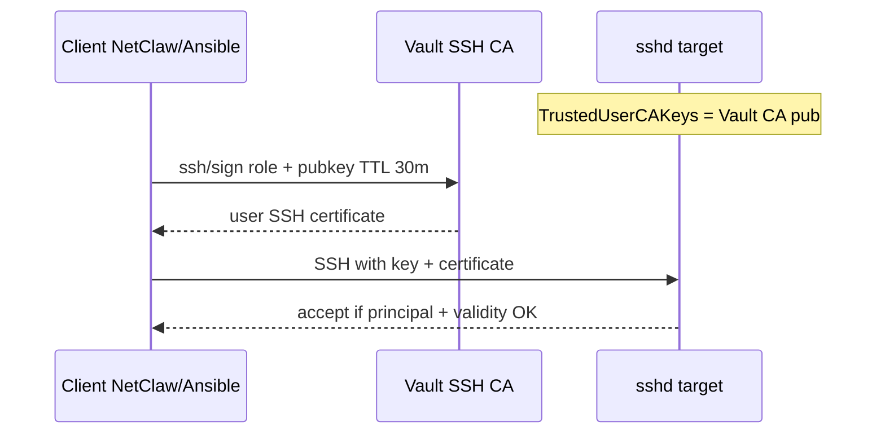
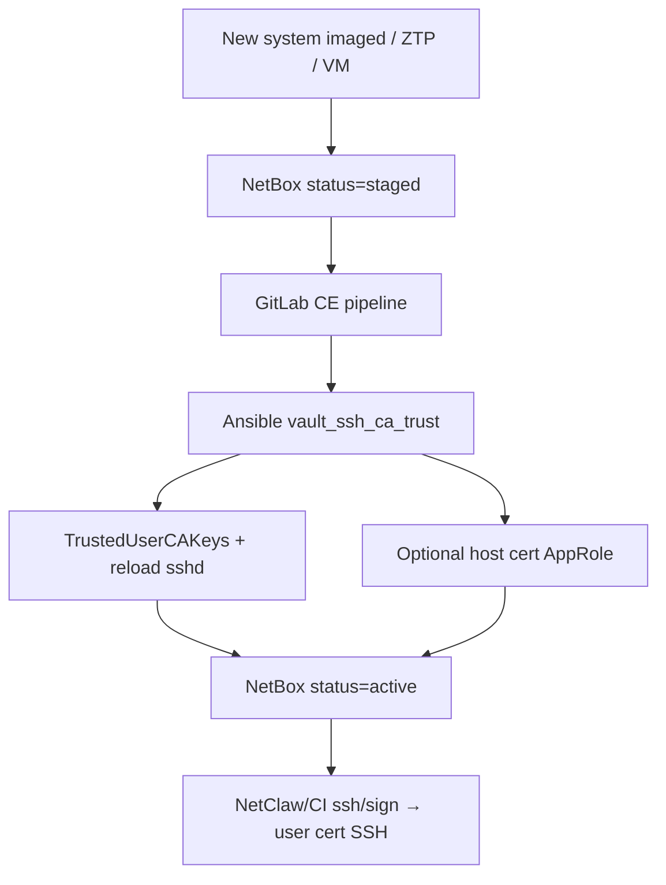
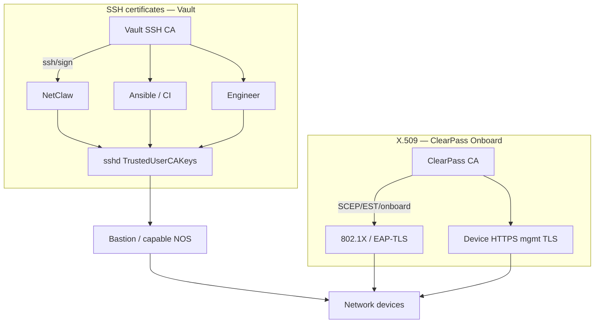

# Vault SSH CA mode and certificate operations

Deep dive for **INSTALL.md §8**. Covers Vault signed SSH certificates, how that differs from **HPE ClearPass Onboard** (X.509), and recommended CA roles in this stack.

Upstream: [Signed SSH certificates](https://developer.hashicorp.com/vault/docs/secrets/ssh/signed-ssh-certificates)

---

## Two different “certificate” worlds

| Concern | Protocol | Typical CA in this environment |
|---------|----------|--------------------------------|
| **SSH login** (NetClaw, Ansible, jump hosts) | OpenSSH **SSH certificates** (not X.509) | **HashiCorp Vault SSH secrets engine (CA mode)** |
| **Network access / 802.1X / EAP-TLS** | **X.509** | **HPE ClearPass Onboard** (you already use this) |
| **HTTPS / API / gNMI / controller TLS** | **X.509** server (and sometimes client) certs | ClearPass Onboard **or** enterprise PKI **or** Vault **PKI** engine |

Vault SSH CA mode does **not** replace ClearPass for NAC. ClearPass Onboard does **not** replace Vault for OpenSSH certificate signing.

---

## Can ClearPass Onboard be used for server certificates?

**Yes — for X.509 server (and client) certificates**, within ClearPass Onboard’s CA model:

- Onboard can run as a **Root CA**, **Intermediate CA** (chained under your enterprise PKI), or **Imported CA**, and can issue **client and server** certificates.
- Enrollment for devices often uses **SCEP** and/or **EST** (ClearPass documents both on the CA).
- That fits: RADIUS/EAP-TLS, captive/onboard flows, and many network/IoT devices that enroll TLS identities for access or management HTTPS.

**No — not for Vault SSH CA mode:**

- OpenSSH `TrustedUserCAKeys` expects an **SSH CA public key** (from Vault `ssh/config/ca`), not an X.509 certificate from ClearPass.
- ClearPass will not sign `ssh-rsa`/`ssh-ed25519` user keys the way `vault write ssh/sign/...` does.
- Do not try to put ClearPass-issued X.509 certs into `authorized_keys` as a substitute for SSH certificates without a custom, non-standard bridge (not recommended).

### Practical split for your org

| Workload | Recommendation |
|----------|----------------|
| 802.1X / device onboard / NAC identity | Keep **ClearPass Onboard** |
| Appliance HTTPS / management TLS that supports SCEP/EST | Prefer **ClearPass Onboard** (or your enterprise PKI via ClearPass as RA) so identity stays in one NAC-aligned PKI |
| SSH to routers/switches/Linux jump hosts for automation | **Vault SSH CA** (user certificates, short TTL) |
| Vault listener TLS, GitLab HTTPS, internal APIs | Enterprise PKI or ClearPass-issued **server** certs where supported; otherwise Vault **PKI** engine or ACME |

---

## Vault SSH CA mode (preferred long-term for automation)

### How it works

1. Vault holds an SSH **signing CA** keypair at `ssh/config/ca`.
2. The **CA public key** is installed on every target as `TrustedUserCAKeys` (and optionally host certs via `HostCertificate`).
3. NetClaw / GitLab CI / an engineer presents a short-lived **user SSH certificate** signed by Vault (principals = OS users such as `netops`).
4. `sshd` trusts the CA; no shared password; TTL expires (e.g. 30m).



```
Client (NetClaw / Ansible)
  → Vault: sign my SSH public key (role netclaw-troubleshoot, TTL 30m)
  → SSH to device with key + certificate
Device sshd
  → TrustedUserCAKeys = Vault CA pub
  → accept if principal + validity OK
```

### Bootstrap CA in Vault

```bash
# Generate Vault-managed SSH CA (back up this carefully — see § Operations)
vault write ssh/config/ca generate_signing_key=true

# Export CA public key for devices
vault read -field=public_key ssh/config/ca > /tmp/vault-ssh-ca.pub
```

To **import** an existing SSH CA keypair instead of generating one (advanced):

```bash
vault write ssh/config/ca \
  private_key=@vault-ssh-ca \
  public_key=@vault-ssh-ca.pub
```

Prefer Vault-generated keys unless you have a strong existing SSH CA process.

### Roles (troubleshoot vs change)

```bash
vault write ssh/roles/netclaw-troubleshoot \
  key_type=ca \
  algorithm_signer=rsa-sha2-256 \
  allow_user_certificates=true \
  allow_host_certificates=false \
  allowed_users=netops \
  default_user=netops \
  allowed_extensions="permit-pty,permit-port-forwarding" \
  default_extensions='{"permit-pty":""}' \
  ttl=30m \
  max_ttl=1h

vault write ssh/roles/netclaw-change \
  key_type=ca \
  algorithm_signer=rsa-sha2-256 \
  allow_user_certificates=true \
  allowed_users=netops \
  default_user=netops \
  ttl=15m \
  max_ttl=30m
```

Bind policies so NetClaw **read** can only hit `ssh/sign/netclaw-troubleshoot` (and optionally `ssh/creds/...`); **change** role is approval-gated ([NETCLAW.md](NETCLAW.md), [SECURITY.md](SECURITY.md)).

### Sign a user certificate (client side)

```bash
ssh-keygen -t ed25519 -f /tmp/netclaw_id -N ""

vault write -field=signed_key ssh/sign/netclaw-troubleshoot \
  public_key=@/tmp/netclaw_id.pub \
  valid_principals=netops \
  ttl=30m > /tmp/netclaw_id-cert.pub

ssh -i /tmp/netclaw_id \
  -o CertificateFile=/tmp/netclaw_id-cert.pub \
  -o IdentitiesOnly=yes \
  netops@lab-rtr-01
```

Ansible: set `ansible_ssh_private_key_file` + `ansible_ssh_extra_args` for the certificate, or use a wrapper that signs just-in-time after JWT/AppRole login ([ANSIBLE.md](ANSIBLE.md)).

### Device / sshd configuration (OpenSSH)

On Linux jump hosts / platforms that run OpenSSH:

```text
# /etc/ssh/sshd_config (or drop-in)
TrustedUserCAKeys /etc/ssh/vault-ssh-ca.pub
# Optional: revoke compromised certs
# RevokedKeys /etc/ssh/revoked_keys
```

```bash
sudo cp /tmp/vault-ssh-ca.pub /etc/ssh/vault-ssh-ca.pub
sudo chmod 644 /etc/ssh/vault-ssh-ca.pub
sudo systemctl reload sshd
```

**Network devices:** support varies by vendor/OS.

| Platform | Typical approach |
|----------|------------------|
| Linux bastion / jump | Native `TrustedUserCAKeys` |
| Cisco IOS-XE / NX-OS / some others | Check current SSH certificate support; often use bastion or TACACS + key auth as interim |
| Vendors without SSH cert support | Keep KV passwords or RADIUS/TACACS; terminate automation SSH on a **bastion** that uses Vault CA |

Pilot on **jump hosts + Linux tooling** first; expand to devices that document OpenSSH-compatible user certificates.

### Optional: host certificates

Vault can also sign **host** certificates (`allow_host_certificates=true`) so clients verify `HostCertificate` / `@cert-authority` in `known_hosts`. Useful for bastions; secondary to user certs for this project.

---

## OTP mode vs CA mode

| | OTP | CA (recommended) |
|--|-----|------------------|
| Client gets | One-time password from Vault | Short-lived signed SSH cert |
| Device needs | `vault-sshhelper` (or similar) calling Vault | Trust Vault CA pubkey only (offline after install) |
| Device outbound to Vault | Usually **required** at login | **Not** required at login |
| Firewall / air-gap devices | Harder | Easier once CA pub is deployed |
| Fit for NetClaw scale | Pilot only | Long-term |

Use OTP to learn the SSH engine; move to **CA mode** for production automation.

---

## Recommendations for CA-mode operations (this stack)

1. **Keep ClearPass Onboard** for X.509 / NAC / device TLS enrollment (SCEP/EST). Chain Onboard as Intermediate under enterprise root if auditors require one PKI tree for NAC.
2. **Use Vault SSH CA** for NetClaw, Ansible, and GitLab-driven SSH to bastions (and devices that support it).
3. **Do not merge PKIs blindly** — SSH CA key material stays in Vault; X.509 stays in ClearPass/enterprise PKI.
4. **Deploy Vault CA public key** via your existing config automation (Ansible) or out-of-band; treat it like trusting a new SSH authority.
5. **Short TTLs** (15–30m troubleshoot, shorter for change); separate Vault roles/policies for read vs change.
6. **Bastion pattern** when network OS lacks SSH certs: human/agent → Vault-signed SSH → bastion → device (TACACS/local), with device secrets still in Vault KV only as needed.
7. **For Vault/GitLab/NetBox HTTPS server certs:** prefer enterprise PKI or ClearPass-issued **server** certs where you already operationalize enrollment; use Vault **PKI** secrets engine when you want API-driven short-lived TLS for services Vault already brokers (optional later).
8. **Backup / rotation of SSH CA:** escrow Vault SSH CA private key material per HashiCorp guidance; rotating the SSH CA means rolling `TrustedUserCAKeys` on all trusts — schedule like a root key ceremony.
9. **Audit:** Vault audit device logs every `ssh/sign`; pair with ClearPass logs for NAC certs — different systems, both retained.
10. **NetBox:** store `vault_ssh_role` (e.g. `netclaw-troubleshoot`) next to `vault_path` ([PATH_LAYOUT.md](PATH_LAYOUT.md), [NETBOX.md](NETBOX.md)).
11. **Zero-touch trust seeding** for new systems — see next section (recommended method for this stack).

---

## Zero-touch seeding: onboard new systems without human SSH

“Seeding” here means making a **new** host or bastion trust the Vault SSH CA (and optionally obtain a **host** certificate) so NetClaw/Ansible can connect with short-lived **user** certs — with **no engineer pasting keys by hand**.

### What must be distributed

| Artifact | Secret? | Where it goes |
|----------|---------|----------------|
| Vault SSH **CA public** key | **No** (trust anchor) | `TrustedUserCAKeys` on every SSH target |
| Vault SSH **CA private** key | **Yes** | **Only inside Vault** — never on endpoints |
| **User** SSH certificates | Short-lived | Issued at connect time to NetClaw/CI (not baked into images) |
| **Host** SSH certificates (optional) | Short-lived / renewable | `/etc/ssh/ssh_host_*_cert` + `HostCertificate` in sshd |

Do **not** bake long-lived user certs into golden images. Seed **trust** (CA pubkey) at provision time; issue **user** certs just-in-time.

### Best method for this stack (recommended)

**NetBox-driven Ansible from GitLab CE (JWT → Vault only for signing/secrets) that applies a `vault_ssh_ca_trust` role on first provisioning.**

Why this is the best fit:

1. You already automate with **Ansible + GitLab runners + NetBox**.
2. The CA **public** key is not secret — safe in git or fetched from Vault with a read-only policy.
3. New systems appear in **NetBox** first (or via discovery); a pipeline/hook runs without a human SSH session.
4. Scales to bastions and any NOS that Ansible can configure; unsupported devices stay behind a seeded bastion.



```
New system imaged / ZTP / VM created
        │
        ▼
NetBox: device created (site, role, mgmt IP, status=staged)
        │
        ▼
GitLab CI (protected) — JWT → Vault (if needed)
        │
        ▼
Ansible: vault_ssh_ca_trust
  - install TrustedUserCAKeys from known CA pubkey
  - reload sshd
  - (optional) enroll host cert via AppRole
        │
        ▼
NetBox: status=active, vault_ssh_role set
        │
        ▼
NetClaw / Ansible: vault write ssh/sign/... → SSH with user cert
```

Example materials: [`../examples/ssh-ca-zero-touch/`](../examples/ssh-ca-zero-touch/).

### Step-by-step (unattended)

#### 1. Publish the CA public key as a non-secret trust anchor

Pick **one** canonical source (prefer A):

| Option | How |
|--------|-----|
| **A. Git (recommended)** | Commit `files/vault-ssh-ca.pub` in the automation repo (or an internal `trust-anchors` repo). Rotate via MR when the SSH CA is rotated. |
| **B. Vault read in CI** | Policy allowing `read` on `ssh/public_key` / CA public only; job writes the file before Ansible runs. |
| **C. Internal HTTPS artifact** | CI publishes `https://artifacts.example.local/ssh/vault-ssh-ca.pub` after CA create/rotate. |

```bash
# One-time (or on CA rotate): capture pubkey into git
vault read -field=public_key ssh/config/ca > ansible/files/vault-ssh-ca.pub
git add ansible/files/vault-ssh-ca.pub   # not a secret
```

#### 2. Ansible role: install trust + harden sshd

Idempotent tasks (concept):

```yaml
- name: Install Vault SSH CA trust anchor
  ansible.builtin.copy:
    src: vault-ssh-ca.pub
    dest: /etc/ssh/vault-ssh-ca.pub
    owner: root
    group: root
    mode: "0644"
  notify: Reload sshd

- name: Trust Vault SSH CA for user certificates
  ansible.builtin.lineinfile:
    path: /etc/ssh/sshd_config.d/99-vault-ca.conf
    create: true
    line: "TrustedUserCAKeys /etc/ssh/vault-ssh-ca.pub"
  notify: Reload sshd
```

Run against hosts with `netbox_device.status=staged` (or a NetBox tag `ssh-ca-pending`) using the normal inventory plugin — **bootstrap credentials** only for this first play (see § Bootstrap credential below).

#### 3. Trigger without a human

| Trigger | Pattern |
|---------|---------|
| **Best default** | NetBox webhook → GitLab pipeline API / scheduled “provision staged devices” job |
| Alternative | GitLab `schedule` every N minutes: query NetBox for `staged` + missing CA trust fact |
| Alternative | Image **cloud-init** / first-boot embeds the same `vault-ssh-ca.pub` (still keep Ansible as source of truth for drift) |
| Network ZTP | Day-0 pushes minimal reachability; Day-1 Ansible (from above) seeds CA trust on the **bastion** path |

#### 4. Optional: unattended **host** certificate enrollment

After trust is in place (or on first boot with AppRole):

1. Host generates host key (normal sshd install).
2. Host authenticates to Vault with **AppRole** (role_id in image; **secret_id** delivered via cloud-init from a wrapping token, or Vault Agent auto-auth).
3. `vault write ssh/sign/host-role public_key=@/etc/ssh/ssh_host_ed25519_key.pub cert_type=host valid_principals=<fqdn>,<ip>`
4. Install cert; set `HostCertificate` in sshd; renew via systemd timer before expiry.

Use a dedicated Vault role `ssh/roles/host-signer` with `allow_host_certificates=true` and tight `allowed_domains` / principals. Prefer **Vault Agent** on Linux VMs for renewal without embedding long-lived tokens.

User certs for NetClaw remain **just-in-time** (never from first-boot seeding).

### Bootstrap credential for the first Ansible connect

Zero-touch CA seeding still needs **one** initial auth path onto a brand-new box:

| Platform | Unattended bootstrap (pick one) |
|----------|----------------------------------|
| Cloud VM / bare metal Linux | cloud-init SSH key from **provisioner** (Terraform/packer injects a **short-lived** builder key or uses instance metadata); then Ansible seeds CA and **removes** builder key |
| Packer golden image | Bake `TrustedUserCAKeys` into the image; new VMs trust Vault CA from first boot — **best for Linux fleets** |
| Network device | ZTP/POAP + TACACS/local enable; Ansible uses Vault KV once; prefer **bastion** with CA trust rather than per-device CA if NOS lacks SSH certs |
| ClearPass | Continues X.509 onboard for NAC; **does not** seed SSH CA |

**Best overall for Linux:** bake the Vault SSH CA **public** key into the **golden image** (Packer), and use NetBox+Ansible only for drift/repair and optional host-cert enrollment.  
**Best overall for mixed network gear:** seed CA on **jump bastions** via NetBox+Ansible; devices stay behind bastions.

### Anti-patterns

| Avoid | Why |
|-------|-----|
| Emailing/scping CA pubkey per new host | Human bottleneck; drift |
| Embedding Vault **root** or long-lived tokens on devices | Compromise blast radius |
| Baking **user** certs into images | Expire or become standing credentials |
| Using ClearPass SCEP/EST to push SSH CA trust | Wrong certificate type |
| One shared bootstrap password left forever | Re-introduces static secrets |

### Acceptance (zero-touch)

- [ ] New lab VM reaches `TrustedUserCAKeys` with **zero** interactive SSH by an engineer
- [ ] CA pubkey sourced from git or automation (not cut-paste)
- [ ] NetClaw/CI can sign user certs and log in after seed
- [ ] Bootstrap builder keys removed or rotated after first converge
- [ ] Host cert renewal (if used) is timer/Agent-based, not manual

---

## ClearPass + Vault coexistence diagram



```
                 ┌─────────────────────┐
                 │ Enterprise / Onboard │
                 │ X.509 CA (ClearPass) │
                 └──────────┬──────────┘
            SCEP/EST / onboard│
        ┌─────────────────────┼─────────────────────┐
        ▼                     ▼                     ▼
   802.1X clients      Device HTTPS           (optional)
   EAP-TLS             mgmt TLS               other TLS

                 ┌─────────────────────┐
                 │ Vault SSH CA        │
                 │ ssh/config/ca       │
                 └──────────┬──────────┘
                     sign│
        ┌────────────────┼────────────────┐
        ▼                ▼                ▼
   NetClaw          Ansible/CI         Engineer
   (user SSH cert)  (user SSH cert)    (user SSH cert)
        └────────────────┼────────────────┘
                         ▼
              sshd TrustedUserCAKeys
              (bastion / capable NOS)
```

---

## Verification checklist

- [ ] `vault read ssh/config/ca` shows a public key
- [ ] Lab bastion has `TrustedUserCAKeys` and accepts a 30m Vault-signed cert
- [ ] NetClaw/Ansible can obtain a cert via AppRole/JWT without passwords in git
- [ ] ClearPass Onboard remains source of truth for NAC X.509; no attempt to use it as SSH CA
- [ ] Decision recorded for appliance HTTPS: ClearPass vs enterprise PKI vs Vault PKI
- [ ] SSH CA private key backup/escrow procedure documented
- [ ] Zero-touch seeding path documented and tested (image bake and/or NetBox→CI→Ansible)

---

## See also

- [INSTALL.md](INSTALL.md) §8 — bootstrap commands in the install flow  
- [PATH_LAYOUT.md](PATH_LAYOUT.md) — `ssh/roles/…` beside KV paths  
- [SECURITY.md](SECURITY.md) — TTLs and least privilege  
- [WORKPLAN.md](WORKPLAN.md) Phase 6 — SSH modernization  
