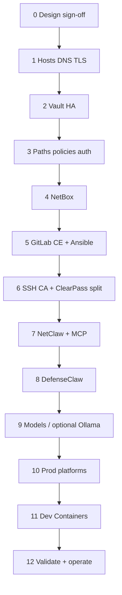

# Complete production install: NetClaw stack

<!-- doc-nav:start -->
> **Hub:** [Documentation home](README.md) · **2. Build**  
> ← [Versions](VERSIONS.md) · [Vault install](INSTALL.md) →
<!-- doc-nav:end -->

End-to-end **production** install for NetClaw and every associated component this repo covers — not Vault alone.

Use this as the **master runbook**. Deep procedures stay in the linked guides; this page is the ordered install, sizing, BOM, and go-live checklist.



Pin all versions ([VERSIONS.md](VERSIONS.md)). Replace every `CHANGE_ME` / example hostname. Fail closed — no plaintext secret fallbacks.

---

## Bill of materials (what you are installing)

| # | Component | Required? | Role | Detail guide |
|---|-----------|-----------|------|--------------|
| 1 | **HashiCorp Vault** (HA Raft) | **Yes** | Secrets SoT, SSH CA | [INSTALL.md](INSTALL.md) |
| 2 | **NetBox Community** | **Yes** | Inventory + `vault_path` | [NETBOX.md](NETBOX.md) |
| 3 | **GitLab CE + Runners** | **Yes** (if CI) | JWT → Vault CLI / Ansible | [GITLAB.md](GITLAB.md) |
| 4 | **Ansible** (+ `community.hashi_vault`) | **Yes** (if automation) | Lookups from Vault | [ANSIBLE.md](ANSIBLE.md) |
| 5 | **OpenClaw + NetClaw** | **Yes** | Agent runtime + skills | [NETCLAW.md](NETCLAW.md) · [MCP.md](MCP.md) |
| 6 | **vault-mcp-server** | **Yes** | Secrets tools for the agent | [MCP.md](MCP.md) · [NETCLAW.md](NETCLAW.md) |
| 7 | **DefenseClaw** | **Yes** (prod) | MCP scan + runtime guardrails | [DEFENSECLAW.md](DEFENSECLAW.md) |
| 8 | **OpenShell** | Optional | Agent sandbox isolation | [DEFENSECLAW.md](DEFENSECLAW.md) |
| 9 | **LLM** (Claude and/or OpenAI and/or Ollama) | **Yes** | Main / Fallback / Compaction | [MODELS.md](MODELS.md) · [LOCAL_LLM.md](LOCAL_LLM.md) |
| 10 | **SSH CA** (Vault) + bastions | **Yes** (recommended) | Short-lived device/bastion SSH | [SSH_CA.md](SSH_CA.md) |
| 11 | **ClearPass Onboard** | Existing | X.509 / NAC PKI (not SSH CA) | [SSH_CA.md](SSH_CA.md) |
| 12 | **Platform MCPs** (CVaaS, Zabbix, Central, ClearPass CPPM, ND SAN, …) | As needed | Controller / NMS / NAC API access | [PRODUCTION_ENVIRONMENTS.md](PRODUCTION_ENVIRONMENTS.md) |
| 13 | **Dev Containers** | Optional | Engineer Vault-backed Ansible | [DEVCONTAINERS.md](DEVCONTAINERS.md) |

Upstream NetClaw installer: [automateyournetwork/netclaw](https://github.com/automateyournetwork/netclaw) `./scripts/install.sh` (pin a release; verify checksums in production).

---

## 0. Design sign-off (before buying VMs)

Complete [WORKPLAN.md](WORKPLAN.md) Phase 0 and [BEST_PRACTICES.md](BEST_PRACTICES.md):

- [ ] Architecture + security reviewed ([ARCHITECTURE.md](ARCHITECTURE.md), [SECURITY.md](SECURITY.md))
- [ ] Main LLM chosen (Claude recommended)
- [ ] RPO/RTO for Vault snapshots defined
- [ ] Stage vs prod path and identity model agreed ([PATH_LAYOUT.md](PATH_LAYOUT.md))
- [ ] List of day-1 platform integrations (from [PRODUCTION_ENVIRONMENTS.md](PRODUCTION_ENVIRONMENTS.md))

**Do not** start NetClaw against production controllers until Vault HA, DefenseClaw observe→action soak, and stage smoke tests pass.

---

## 1. Hosts, DNS, TLS, sizing

### Suggested host roles

| Host / cluster | Qty (prod) | Sizing start | Notes |
|----------------|------------|--------------|--------|
| **Vault** | 3 (or 5) | 4 vCPU / 8 GB / 100+ GB SSD | Dedicated; [INSTALL.md](INSTALL.md) |
| **NetBox** | 1+ (HA per your org) | 4 vCPU / 8 GB / 50+ GB | Postgres + Redis as you already run |
| **GitLab CE + DB** | Existing | — | Must support `id_tokens` |
| **GitLab Runners** | ≥1 protected | 4 vCPU / 8 GB | Reach Vault VIP + targets |
| **NetClaw / OpenClaw** | 1+ | 8 vCPU / 16 GB / 100 GB | Node.js 20+; Python 3.10+ |
| **DefenseClaw sidecar** | On NetClaw host | included above | Loopback `:4000` |
| **Ollama** (if local LLM) | 0–1 GPU | GPU per [LOCAL_LLM.md](LOCAL_LLM.md) | Optional |
| **SSH bastions** | ≥2 | 2 vCPU / 4 GB | Trust Vault SSH CA pubkey |

### DNS / TLS

| Name | Points to |
|------|-----------|
| `vault.example.local` | Vault VIP / LB |
| `netbox.example.local` | NetBox |
| `gitlab.example.local` | GitLab |
| `netclaw.example.local` | Agent host (admin UI / gateway if exposed) |
| `ollama.example.local` | Optional GPU host |

- Issue TLS from enterprise/internal CA for Vault (and ideally NetBox/GitLab).
- Distribute CA bundle to every consumer (`VAULT_CACERT`, system trust).
- Never `VAULT_SKIP_VERIFY` or `tls_disable` with real secrets.

### Network allowlist (minimum)

| From | To | Port |
|------|-----|------|
| Runners, NetClaw, NetBox, bastions, admins | Vault VIP | 8200 |
| Vault nodes | each other | 8200, 8201 |
| NetClaw | NetBox, GitLab, LLM APIs / Ollama, platform APIs | 443 / vendor |
| NetClaw / Runners | Bastions / XR mgmt | 22 (scoped) |
| Vault | GitLab (JWT discovery/JWKS) | 443 |

---

## 2. Install Vault (HA)

Follow **[INSTALL.md](INSTALL.md)** in full:

1. Pin and install Vault on 3+ nodes  
2. Raft + TLS + auto-unseal  
3. Init; escrow recovery keys; revoke root after admin identity  
4. Audit → SIEM  
5. Enable `secret/` (KV v2) + `ssh/`  
6. Raft snapshot schedule + restore drill  

**Gate:** `vault status` unsealed; `raft list-peers` healthy; test audit event in SIEM.

---

## 3. Paths, policies, auth methods

1. Adopt Strategy A — [PATH_LAYOUT.md](PATH_LAYOUT.md)  
2. Write policies — [`../policies/`](../policies/README.md) (`gitlab-ci`, `gitlab-ci-prod`, `netclaw-read`, `netclaw-change`, `ansible-automation`, `netbox-agent`)  
3. Enable auth — [INSTALL.md](INSTALL.md) §7:
   - **JWT** for GitLab  
   - **AppRole** for NetClaw (and controllers as needed)  
   - **OIDC** for humans / Dev Containers  
4. Create AppRole `netclaw`; deliver `role_id` / `secret_id` out of band  
5. Load **stage** platform + device secrets first; prod under change control  

**Gate:** Non-root token can read `secret/network/stage/…` and is **denied** `prod/` until intended.

---

## 4. Install / harden NetBox

If NetBox is new, install NetBox Community per upstream docs (Postgres, Redis, TLS, gunicorn/nginx). Then wire Vault:

1. Create least-privilege NetBox API token  
2. Store in Vault: `secret/platform/netbox` — [NETBOX.md](NETBOX.md)  
3. Add custom fields: `vault_path`, `vault_ssh_role`, `credential_env`, controller tags  
4. Import / tag devices for day-1 targets (XR, SAN, etc.)  
5. Confirm UI never holds device passwords  

**Gate:** Automation resolves device → `vault_path` → Vault read without passwords in NetBox.

---

## 5. GitLab CE + Ansible

### GitLab CE

1. Confirm CE + Runner support `id_tokens` — [GITLAB.md](GITLAB.md)  
2. Configure Vault JWT (`oidc_discovery_url` = GitLab; Vault trusts GitLab CA)  
3. Create **separate** JWT roles: `gitlab-network-stage` / `gitlab-network-prod`  
4. Set non-secret CI variables: `VAULT_ADDR`, `VAULT_AUTH_ROLE`, `VAULT_CACERT` (File)  
5. Add smoke job from [`../examples/gitlab-ci-ce.yml`](../examples/gitlab-ci-ce.yml) (pinned Vault image)  
6. Remove plaintext password CI variables after validation  

### Ansible

1. Pin `community.hashi_vault` + `hvac` in CI/controller images — [ANSIBLE.md](ANSIBLE.md)  
2. Commit path maps only (`vault_paths.yml`)  
3. Wire JWT → `VAULT_TOKEN` → lookups; `no_log: true` on secret tasks  
4. Stage playbook first; promote prod inventory + JWT role  

**Gate:** Protected-branch stage job reads Vault; MR denied for `prod/`; no secrets in job logs.

---

## 6. SSH CA + ClearPass

1. Create Vault SSH CA + troubleshoot/change roles — [INSTALL.md](INSTALL.md) §8, [SSH_CA.md](SSH_CA.md)  
2. Keep **ClearPass Onboard** for X.509 / NAC only  
3. Distribute **CA public key** to bastions (golden image and/or NetBox→GitLab→Ansible zero-touch)  
4. Never bake user certs into images  
5. Test ≤30m signed cert login to stage bastion  

**Gate:** Bastion accepts Vault-signed cert; zero-touch path documented for new hosts.

---

## 7. Install NetClaw + OpenClaw + vault-mcp

### 7.1 Agent host prerequisites

| Requirement | Minimum |
|-------------|---------|
| OS | Ubuntu 24.04 LTS (or org standard) |
| Node.js | 20+ (match NetClaw/OpenClaw pin) |
| Python | 3.10+ |
| curl, git, sha256sum | present |
| Reachability | Vault VIP, NetBox, GitLab, LLM APIs, day-1 platforms |

### 7.2 Install OpenClaw + NetClaw (pinned)

```bash
# Example — pin versions from VERSIONS.md / NetClaw release notes
# Prefer NetClaw's release tarball or git tag + verified install.sh — do not pipe unverified main to bash in prod

cd /opt/src
git clone --branch <PINNED_TAG> https://github.com/automateyournetwork/netclaw.git
cd netclaw
# Review scripts/install.sh, then:
./scripts/install.sh --profile recommended
# or component list matching your BOM, e.g. vault netbox pyats zabbix …
```

Onboard provider/gateway per NetClaw docs (`openclaw onboard` / configure). Run gateway as a **systemd** service (not a forgotten tmux).

### 7.3 vault-mcp-server

```bash
# Install pinned vault-mcp-server binary onto PATH
command -v vault-mcp-server
```

### 7.4 Vault AppRole on the host

```bash
sudo mkdir -p /etc/netclaw
sudo install -m 600 /dev/null /etc/netclaw/vault.env
# Write VAULT_ADDR, VAULT_CACERT, VAULT_ROLE_ID, VAULT_SECRET_ID (from secure channel)
```

Systemd `ExecStartPre` / timer renews `VAULT_TOKEN` from AppRole ([NETCLAW.md](NETCLAW.md)). **Never** root token; **never** commit `vault.env`.

### 7.5 Register MCP

See [MCP.md](MCP.md). Minimal `mcpServers` entry: [`../examples/openclaw-vault.json`](../examples/openclaw-vault.json).

```bash
openclaw gateway restart   # or systemctl restart openclaw-gateway
```

**Gate:** Chat can list Vault mounts / stage paths with **redacted** values; Vault audit shows AppRole.

---

## 8. Install DefenseClaw (required for production)

Follow [DEFENSECLAW.md](DEFENSECLAW.md):

1. Pin DefenseClaw release; verify `install.sh` against `checksums.txt`  
2. Prefer NetClaw `./scripts/defenseclaw-enable.sh` with `DEFENSECLAW_VERSION=…`  
3. OpenClaw connector; `security.mode=defenseclaw`  
4. Durable `defenseclaw-gateway` (systemd)  
5. Start in **observe**; soak on stage; promote to **action**  
6. `defenseclaw mcp set vault-mcp` + `scan`  
7. Block write/destructive tools by default  
8. Optional OpenShell with allowlisted egress  

**Gate:** Sidecar on loopback; MCP scan clean; observe→action decision recorded.

---

## 9. Models (and optional Ollama)

1. Choose Main / Fallback / Compaction — [MODELS.md](MODELS.md)  
2. Store provider API keys in Vault or host secret files (not git)  
3. If local/hybrid: install pinned Ollama + models — [LOCAL_LLM.md](LOCAL_LLM.md)  
4. Register custom provider domains with DefenseClaw (required for Ollama)  

**Gate:** One stage troubleshooting turn completes with tools; no API keys in the repo.

---

## 10. Wire production platforms (day-1 subset)

Use [PRODUCTION_ENVIRONMENTS.md](PRODUCTION_ENVIRONMENTS.md). Suggested first wave:

1. Zabbix + Observium (read)  
2. Arista CVaaS + Cloudflare (read)  
3. IOS-XR via SSH CA (stage)  
4. Nexus Dashboard SAN (read)  
5. Then Central, Strata, EdgeConnect, VeloCloud, EPNM, SolidServer, **ClearPass Policy Manager** (API read; Onboard stays X.509)  

For each:

1. Vault `secret/platform/…`  
2. NetBox metadata  
3. MCP register + DefenseClaw scan  
4. Egress allowlist  
5. Read-only smoke test  

Snippets: [`../examples/production-envs/`](../examples/production-envs/).

**Gate:** At least one NMS + one SaaS controller + one XR path validated.

---

## 11. Dev Containers (engineers)

1. Strip secrets from git — [DEVCONTAINERS.md](DEVCONTAINERS.md)  
2. Host `vault login` (OIDC) → `remoteEnv`  
3. Same playbooks as CI; different audit identity  
4. Stage-scoped human policy  

**Gate:** Rebuild works with empty secret tree; missing token fails closed.

---

## 12. Validate, cut over, operate

### End-to-end acceptance

- [ ] Vault HA + snapshot restore drill  
- [ ] Stage/prod policy isolation proven  
- [ ] GitLab CE JWT smoke (stage); prod role protected  
- [ ] Ansible lookups without Ansible Vault password  
- [ ] NetClaw + vault-mcp + DefenseClaw action mode  
- [ ] SSH CA bastion login ≤30m TTL  
- [ ] Day-1 platforms read-only OK  
- [ ] No device passwords in GitLab, NetBox, or git  
- [ ] SIEM receives Vault audit + DefenseClaw alerts  

### Operate

- Rotation calendar — [SECURITY.md](SECURITY.md)  
- Change windows — [DEFENSECLAW.md](DEFENSECLAW.md) + `netclaw-change`  
- Workplan Phase 7 — [WORKPLAN.md](WORKPLAN.md)  

Checklist copy: [`../examples/stack-install/checklist.md`](../examples/stack-install/checklist.md)

---

## Quick map (step → guide)

| Step | Guide |
|------|--------|
| 2 Vault HA | [INSTALL.md](INSTALL.md) |
| 3 Paths / policies | [PATH_LAYOUT.md](PATH_LAYOUT.md) · [../policies/](../policies/) |
| 4 NetBox | [NETBOX.md](NETBOX.md) |
| 5 GitLab / Ansible | [GITLAB.md](GITLAB.md) · [ANSIBLE.md](ANSIBLE.md) |
| 6 SSH CA | [SSH_CA.md](SSH_CA.md) |
| 7–8 NetClaw / MCP / DefenseClaw | [MCP.md](MCP.md) · [NETCLAW.md](NETCLAW.md) · [DEFENSECLAW.md](DEFENSECLAW.md) |
| 9 Models | [MODELS.md](MODELS.md) · [LOCAL_LLM.md](LOCAL_LLM.md) |
| 10 Platforms | [PRODUCTION_ENVIRONMENTS.md](PRODUCTION_ENVIRONMENTS.md) |
| 11 Dev Containers | [DEVCONTAINERS.md](DEVCONTAINERS.md) |
| Practices | [BEST_PRACTICES.md](BEST_PRACTICES.md) |

<!-- doc-footer:start -->
---

**Hub:** [Documentation home](README.md) · **Reading path:** [Design](ARCHITECTURE.md) → [Build](INSTALL.md) → [Integrate](GITLAB.md) → [Agent](NETCLAW.md) → [Reference](DIAGRAMS.md)
<!-- doc-footer:end -->
