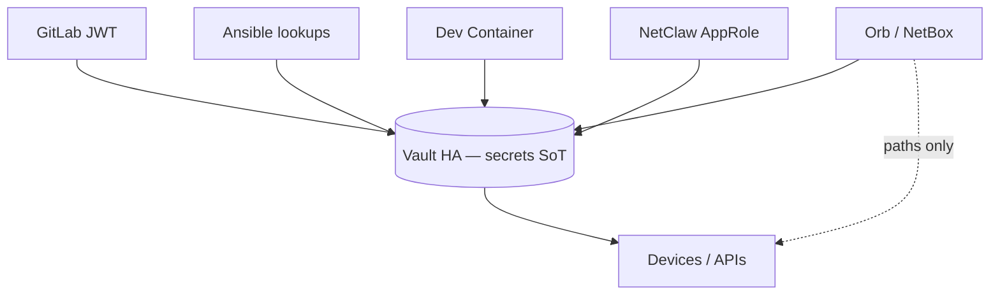
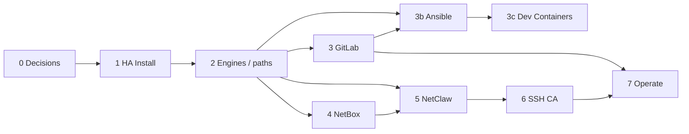

# Workplan: HashiCorp Vault for NetClaw + GitLab + NetBox

<!-- doc-nav:start -->
> **Hub:** [Documentation home](README.md) · **1. Design**  
> ← [Security](SECURITY.md) · [Best practices](BEST_PRACTICES.md) →
<!-- doc-nav:end -->

## Goal

Replace static GitLab CI variables, Ansible Vault files, Dev Container `.env` secrets, and other ad-hoc credential stores with a **production-grade HashiCorp Vault cluster** as the single secrets system of record for network troubleshooting automation and NetClaw agents.

This workplan is the **delivery checklist**. Concepts: [ARCHITECTURE](ARCHITECTURE.md), [SECURITY](SECURITY.md). Doc map: [Documentation home](README.md).

## Current state (baseline)

- GitLab on-prem + GitLab Runners
- Ansible playbooks (often Ansible Vault and/or CI-injected passwords)
- VS Code Dev Containers that need the same secrets locally
- NetBox Community (inventory SoT)
- Credentials likely in CI variables, local files, or device shared accounts
- Target: NetClaw for advanced agentic troubleshooting against **production** network gear (with stage validation first)

## Target state



**Rules**

1. Vault holds secrets; NetBox holds inventory + optional Vault *path* references.
2. Prefer short-lived **SSH certificates** over static passwords for agents.
3. Separate **read/troubleshoot** vs **change/write** Vault policies; separate **stage** vs **prod** CI roles.
4. Every secret read is audited and shipped to SIEM.
5. Same Vault **paths** for CI Ansible and Dev Container Ansible; different **auth** identities.
6. Consumers **fail closed** when Vault is down.

---

## Phase 0 — Decisions & prerequisites

**Outcomes**

- [ ] Choose Vault edition: **OSS/Community** (pinned 2.x) or Enterprise — [VERSIONS.md](VERSIONS.md)
- [ ] Commit to **3+ node Raft HA**, TLS from enterprise/internal CA, **auto-unseal**
- [ ] Pin package/image versions via change control (no `:latest` in prod)
- [ ] Choose auth: **JWT** (GitLab), **AppRole** (NetClaw/controllers), **OIDC** (humans / Dev Containers)
- [ ] Choose NetClaw **Main** LLM: Claude (recommended), OpenAI (if mandated), or local (air-gap) — [MODELS.md](MODELS.md)
- [ ] If local: production Ollama host + pinned models — [LOCAL_LLM.md](LOCAL_LLM.md)
- [ ] Require **DefenseClaw** for NetClaw production (OpenShell optional) — [DEFENSECLAW.md](DEFENSECLAW.md)
- [ ] Confirm network path: Runners, NetBox, NetClaw, admins → Vault VIP:8200
- [ ] Define RPO/RTO for Raft snapshot restore

**Acceptance**

- Written architecture + security sign-off
- Host sizing ≥ HashiCorp guidance for expected QPS + audit retention ([INSTALL.md](INSTALL.md))

---

## Phase 1 — Vault install & harden

**Tasks**

- [ ] Install pinned Vault on 3+ dedicated nodes
- [ ] Configure Raft + TLS listeners; VIP / LB health checks
- [ ] Configure auto-unseal; init; escrow recovery keys + root
- [ ] Enable audit; ship logs off-box
- [ ] Create admin identity; **revoke root**
- [ ] Schedule Raft snapshots; run restore drill on isolated cluster

**Acceptance**

- `vault status` sealed=false; `raft list-peers` shows all voters
- Auto-unseal survives node reboot without human Shamir
- Audit receives a test read in SIEM
- Successful snapshot restore drill recorded

**Guide:** [INSTALL.md](INSTALL.md) §0–3, §9

---

## Phase 2 — Secrets engines & path design

**Mounts**

| Mount | Engine | Purpose |
|-------|--------|---------|
| `secret/` | KV v2 | Static device creds, API tokens, enable secrets |
| `ssh/` | SSH CA | Short-lived signed SSH certs |
| `pki/` (optional) | PKI | Only if ClearPass/enterprise PKI is not the X.509 path |

**Path convention (Strategy A — default)**

```
secret/data/network/{env}/{site}/{device}/credentials
secret/data/platform/netbox
ssh/roles/netclaw-troubleshoot
ssh/roles/netclaw-change
```

**Envs:** `stage`, `prod` (optional isolated `lab` gear — not a Vault install mode)

**Tasks**

- [ ] Lock Strategy A — [PATH_LAYOUT.md](PATH_LAYOUT.md)
- [ ] Document field names (`username` / `password` / `enable_secret`)
- [ ] Align NetBox `vault_path` with Vault
- [ ] Apply separate policies: stage CI, prod CI, NetClaw read/change

**Acceptance**

- Stage secrets loaded; prod secrets loaded under change control
- Policies applied and tested with non-root tokens
- Team runbook names the chosen strategy

**Guide:** [PATH_LAYOUT.md](PATH_LAYOUT.md) · [INSTALL.md](INSTALL.md) §4–6 · [SECURITY.md](SECURITY.md)

---

## Phase 3 — GitLab + Runners

**Tasks**

- [ ] Confirm edition: **CE** → JWT + Vault CLI; Premium+ may use `secrets:vault`
- [ ] Configure Vault JWT auth for GitLab issuer (Vault trusts GitLab CA)
- [ ] Separate JWT roles: stage vs prod (`ref_protected`, environment claims)
- [ ] Example `.gitlab-ci.yml` with `id_tokens` + Vault CLI — [GITLAB.md](GITLAB.md)
- [ ] Migrate pipelines off CI-stored passwords
- [ ] Ensure MR pipelines cannot read `prod/`

**Acceptance**

- Protected-branch stage job reads `secret/network/stage/...` on CE
- Prod role works only on protected prod refs; MR denied for `prod/`
- No device password visible in job logs

**Guide:** [GITLAB.md](GITLAB.md)

---

## Phase 3b — Ansible playbooks

**Tasks**

- [ ] Inventory Ansible Vault files, plaintext creds, and CI password variables
- [ ] Pin `community.hashi_vault` + `hvac` in CI images and Dev Containers
- [ ] Introduce plaintext `vault_paths.yml`; switch playbooks to `vault_kv2_get`
- [ ] Wire GitLab JWT → `VAULT_TOKEN` for Ansible jobs
- [ ] Apply `no_log: true`; remove Ansible Vault after stage sign-off; then prod

**Acceptance**

- Stage playbook in CI with **no** Ansible Vault password and **no** device password CI variables
- Prod playbook uses prod JWT role only
- Vault audit shows JWT/AppRole identity on secret reads

**Guide:** [ANSIBLE.md](ANSIBLE.md) · `examples/ansible/`

---

## Phase 3c — VS Code Dev Containers

**Tasks**

- [ ] Strip secrets from `.env`, Dockerfile, and `devcontainer.json`
- [ ] Pass `VAULT_ADDR` / token via `remoteEnv` + OIDC host login
- [ ] Document host `vault login` (OIDC) before “Reopen in Container”
- [ ] Smoke-test: same playbooks as CI, using engineer identity (not CI JWT)

**Acceptance**

- Container rebuild works with empty git tree for secrets
- Missing token fails closed
- Audit distinguishes human OIDC from CI JWT

**Guide:** [DEVCONTAINERS.md](DEVCONTAINERS.md)

---

## Phase 4 — NetBox Community

**Tasks**

- [ ] Create dedicated NetBox API token; store in Vault
- [ ] Add `vault_path` (and optional `vault_ssh_role`) convention
- [ ] (Optional) Orb Agent `secrets_manager: vault`
- [ ] Document: NetBox UI never stores plaintext device passwords

**Acceptance**

- Automation resolves device → Vault path → credential without NetBox holding the secret
- NetBox token rotatable without code changes

**Guide:** [NETBOX.md](NETBOX.md)

---

## Phase 5 — NetClaw integration

**Tasks**

- [ ] Select Main / Fallback / Compaction models ([MODELS.md](MODELS.md)); store API keys outside git
- [ ] If local/hybrid: production Ollama + pinned models ([LOCAL_LLM.md](LOCAL_LLM.md))
- [ ] Register HashiCorp `vault-mcp-server`
- [ ] Auth with **AppRole**; apply `netclaw-read` (stage first)
- [ ] Install **DefenseClaw** (pinned release, checksum-verified); OpenClaw connector; durable sidecar ([DEFENSECLAW.md](DEFENSECLAW.md))
- [ ] Register + scan `vault-mcp`; guardrails **observe** then **action** on stage
- [ ] Register custom LLM providers (e.g. Ollama) so DefenseClaw does not fail-closed unknown domains
- [ ] Verify secrets are **injected**, never echoed
- [ ] Wire DefenseClaw tool blocks + Vault `netclaw-change` for approved change windows
- [ ] Explicit change control before enabling `prod/` reads
- [ ] Optional: OpenShell sandbox with allowlisted Vault / NetBox / GitLab / LLM egress
- [ ] Connect production platforms per [PRODUCTION_ENVIRONMENTS.md](PRODUCTION_ENVIRONMENTS.md) (read-only first): Strata Cloud Manager, CVaaS, VeloCloud, EPNM, Zabbix, Observium, Aruba Central classic/CNX, Cloudflare, IOS-XR SSH, SolidServer, EdgeConnect GM

**Acceptance**

- NetClaw connects to stage devices using Vault-sourced creds or SSH certs
- At least one SaaS controller + one NMS + one XR path validated with Vault + DefenseClaw
- Chat/UI shows redacted values only
- Vault audit shows agent identity on each read
- DefenseClaw sidecar up; MCP scan clean; observe→action soak recorded
- Change-window drill: allow tools → elevate → revoke → re-block
- Prod path access only after sign-off

**Guide:** [NETCLAW.md](NETCLAW.md) · [DEFENSECLAW.md](DEFENSECLAW.md) · [PRODUCTION_ENVIRONMENTS.md](PRODUCTION_ENVIRONMENTS.md) · [MODELS.md](MODELS.md) · [LOCAL_LLM.md](LOCAL_LLM.md)

---

## Phase 6 — SSH modernization

**Tasks**

- [ ] Enable SSH secrets engine in **CA mode** ([INSTALL.md](INSTALL.md) §8, [SSH_CA.md](SSH_CA.md))
- [ ] Keep **ClearPass Onboard** for X.509 / NAC / device TLS — not as SSH CA
- [ ] Deploy Vault SSH CA public key on stage then prod bastions
- [ ] Implement **zero-touch** CA trust seeding (golden image and/or NetBox→GitLab→Ansible)
- [ ] NetClaw / runners request short-lived signed certs per session
- [ ] Retire shared static passwords where possible

**Acceptance**

- Bastion login with Vault-signed SSH cert; TTL ≤ 30 minutes
- New host trusts SSH CA with **no** interactive engineer SSH
- Written split: ClearPass = X.509; Vault = SSH CA
- Static password path marked deprecated

---

## Phase 7 — Operate & harden

**Tasks**

- [ ] Rotation runbook (NetBox token, AppRole secret-id, device creds, TLS)
- [ ] Alert on seal, peer loss, audit disk, auth failures, prod read spikes
- [ ] Backup Raft snapshots + restore drill cadence
- [ ] Quarterly policy review (prod change role membership)

**Acceptance**

- Documented RTO for Vault restore
- Successful restore drill recorded
- On-call playbooks published

---

## Suggested order of execution



| Order | Phase | Depends on |
|------:|-------|------------|
| 1 | 0 Decisions | — |
| 2 | 1 Install (HA) | 0 |
| 3 | 2 Engines/paths | 1 |
| 4 | 3 GitLab | 2 |
| 5 | 3b Ansible | 2–3 |
| 6 | 3c Dev Containers | 2 (+ 3b for shared playbooks) |
| 7 | 4 NetBox | 2 |
| 8 | 5 NetClaw | 2 (+ ideally 4) |
| 9 | 6 SSH engine | 5 |
| 10 | 7 Operate | 3–6 |

Promote **stage → prod** for each consumer after audit review. Phases 3 / 3b / 4 can overlap after Phase 2.

---

## Out of scope (for later)

- CyberArk / enterprise PAM session recording (if mandated, front human break-glass; keep Vault for automation)
- Vault Enterprise performance/DR replication (evaluate if multi-site RPO requires it)
- Full device-fleet SSH cert support on every NOS (bastion pattern covers gaps)

---

## Success metrics

- Zero production device passwords in GitLab CI variables
- Zero Ansible Vault / committed `.env` passwords required for stage or prod playbooks
- Dev Containers run the same playbooks using Vault auth (no secrets in the image)
- 100% of NetClaw device access audited in Vault
- DefenseClaw guardrails in **action** mode for production NetClaw; change windows dual-gated
- Separate policies for troubleshoot vs change and stage vs prod
- HA Raft peers healthy; restore drill within documented RTO
- Time-to-rotate NetBox API token &lt; 15 minutes (procedure only; no code deploy)

<!-- doc-footer:start -->
---

**Hub:** [Documentation home](README.md) · **Reading path:** [Design](ARCHITECTURE.md) → [Build](INSTALL.md) → [Integrate](GITLAB.md) → [Agent](NETCLAW.md) → [Reference](DIAGRAMS.md)
<!-- doc-footer:end -->
