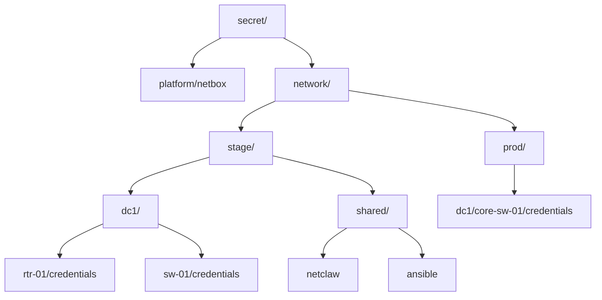

# Path layout examples

Canonical design: **Strategy A** — `network/{env}/{site}/{device}/credentials` on KV mount `secret/` with primary envs **`stage`** and **`prod`**.

Full guidance: [`../../docs/PATH_LAYOUT.md`](../../docs/PATH_LAYOUT.md) · **Hub:** [../../docs/README.md](../../docs/README.md)

## Tree (logical)



```
secret/                                 # kv-v2 mount
├── platform/
│   └── netbox                          # api_token, url
└── network/
    ├── stage/
    │   ├── dc1/
    │   │   ├── rtr-01/
    │   │   │   └── credentials         # username, password, enable_secret
    │   │   └── sw-01/
    │   │       └── credentials
    │   └── shared/
    │       ├── netclaw
    │       └── ansible
    └── prod/
        └── dc1/
            └── core-sw-01/
                └── credentials
```

## Seed commands

See [`seed-strategy-a.sh`](seed-strategy-a.sh) (placeholders only — not a production loader).

## Policy globs (stage automation)

```hcl
path "secret/data/network/stage/*" { capabilities = ["read"] }
path "secret/metadata/network/stage/*" { capabilities = ["list", "read"] }
path "secret/data/platform/netbox" { capabilities = ["read"] }
```

Use a **separate** policy/role for `network/prod/*`.
