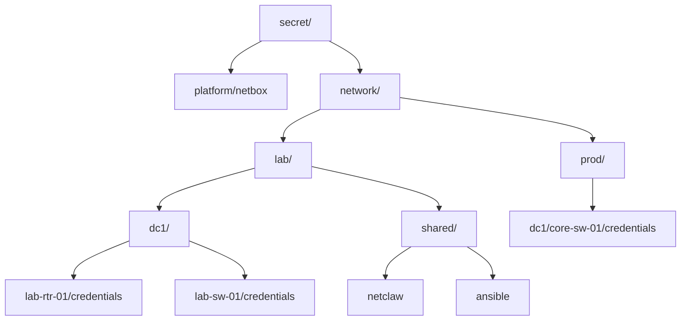

# Path layout examples

Canonical design: **Strategy A** — `network/{env}/{site}/{device}/credentials` on KV mount `secret/`.

Full guidance: [`../../docs/PATH_LAYOUT.md`](../../docs/PATH_LAYOUT.md)

## Tree (logical)



```
secret/                                 # kv-v2 mount
├── platform/
│   └── netbox                          # api_token, url
└── network/
    ├── lab/
    │   ├── dc1/
    │   │   ├── lab-rtr-01/
    │   │   │   └── credentials         # username, password, enable_secret
    │   │   └── lab-sw-01/
    │   │       └── credentials
    │   └── shared/
    │       ├── netclaw
    │       └── ansible
    ├── stage/
    │   └── …
    └── prod/
        └── dc1/
            └── core-sw-01/
                └── credentials
```

## Seed commands

See [`seed-strategy-a.sh`](seed-strategy-a.sh) (placeholders only).

## Policy globs (lab automation)

```hcl
path "secret/data/network/lab/*" { capabilities = ["read"] }
path "secret/metadata/network/lab/*" { capabilities = ["list", "read"] }
path "secret/data/platform/netbox" { capabilities = ["read"] }
```
